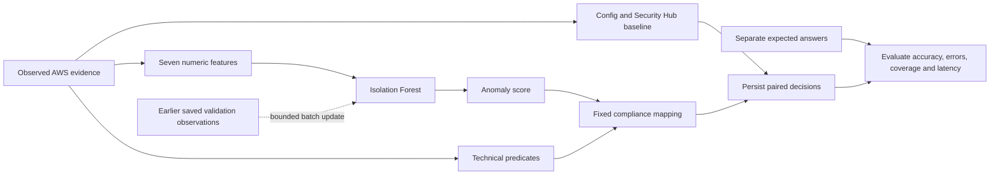

# Where AI and ML enter the dissertation software

The AI-driven monitor now has a real, executable **Isolation Forest** implementation using scikit-learn. This is a development prototype running on local CPU with synthetic engineering fixtures. It has not been trained or evaluated on AWS dissertation observations. The deployed AWS baseline stays paused.

The baseline and AI approach will receive equivalent resources, telemetry and observation windows through a future controller. Config/Security Hub provide the baseline decisions. The AI pipeline converts observed activity to numeric features, scores unusual patterns, then applies a fixed technical compliance mapping. Ground truth enters only during later evaluation.



## What the model learns

Isolation Forest learns the distribution of unlabeled reference observations. The proposed features are mutation count, policy-change count, public-access-setting-change count, versioning-change count, principal count, configuration-delta count, and failed-request fraction. Count inputs use log1p; the fraction remains on its original scale. The model receives neither scenario labels nor IDs as numeric features.

These feature names are a development proposal. The AWS extraction implementation, event definitions, window/cutoff semantics and feature validity must be specified and tested before freezing. A future collector must use only evidence available by the shared prediction cutoff, preserve identical paired observation provenance and distinguish missing telemetry from a true zero. This prototype cannot verify those collection properties.

Initial training accepts only training-role rows; a separate validation/adaptation anchor calibrates the threshold without answer-key labels. Training and anchor groups must be disjoint. Both currently require complete technically clean observations (all proposed state predicates true). That guard uses observed technical state, not independent ground truth; it does not establish that reference data are free of every possible hidden fault. Held-out observations cannot fit or calibrate the model.

The current draft S3 catalog has only one conservative overlap group, so it cannot yet supply these independent partitions. Synthetic tests use explicitly separate engineering groups to exercise the code. They do not resolve the real study's independence or sampling design.

## From anomaly to compliance

scikit-learn's score_samples is oriented toward normality. The software negates it, so larger exported scores mean greater anomaly. It calibrates the proposed 0.98 quantile on the separate anchor with a retained random seed and fixed forest settings. Scores are not probabilities of noncompliance.

| Score gate | Technical evidence | Output |
| --- | --- | --- |
| At or above threshold | Confirms a stated violation | noncompliant |
| Below threshold | Satisfies all required predicates | compliant |
| Any other combination | Missing, conflicting or insufficient support | unknown |

The mapping has development targets for S3 TLS, all four bucket access blocks, versioning, TLS plus access blocks, versioning over the observation window, and TLS plus versioning over that window. An intermediate violation followed by restoration is retained by temporal predicates. Technical fact extraction and attribution remain future work. Partial evidence can establish a violation if one required conjunction term is false, but cannot establish compliance while required terms are missing.

The mapping is deterministic and does not request runtime human classification. It does not silently convert a technically corroborated low-scoring violation into an anomaly detection. A preliminary synthetic probe returned unknown because its score did not cross the threshold. That result remains intact; thresholds were not changed to force a desired probe result. No accuracy, false-positive rate, coverage or empirical improvement is reported from synthetic examples.

## Bounded adaptation

Proposed settings are retained in `protocol/ml-development-v0.1.json`: 128 trees, seed 997, at most 256 samples per tree, minimum 32 training and 16 anchor observations. These values remain to validate and freeze.

Updates are eligible only before predefined future batches 4, 6, 8 and 10. Each accepted update admits at most 32 new rows, at most 20 percent of the resulting pool, at most 512 total fitted rows, and at most four updates. This intake percentage is not an estimated contamination rate. Only previously completed validation/adaptation observations are eligible; their AI determination must already have been scored and saved, with matching checksum, model version, outcome, protocol and observation hash. Fitted/anchor IDs, current or future batches, held-out rows, known technical violations and incomplete technical state are rejected. Related groups cannot move between learning roles.

The candidate is a fresh forest with unchanged hyperparameters and seed. It is checked against the fixed validation anchor. Excessive anchor-score movement rejects the candidate; per-update threshold movement is limited to 0.025 and cumulative movement to 0.05 from the initial threshold. Failed candidates retain the existing forest, pool and threshold and append a rejection audit. Accepted updates retain the before/after versions and source-receipt hashes. No held-out labels or held-out performance metric selects an update.

The catalog assignment manifest and live experiment controller are not integrated yet: row-role declarations and observed group history are programmatic safeguards, not authentication of scientific independence. Formal pilot/confirmatory inputs remain disabled. Protocol review must resolve adaptation eligibility, reference-data contamination protections, anchor adequacy and these proposed limits before collection.

## Reproducibility and checks

`requirements-ml.txt` pins all five scientific packages. The isolated environment uses scikit-learn 1.7.2, NumPy 2.3.5, SciPy 1.16.3, joblib 1.5.2 and threadpoolctl 3.6.0. CI creates its own virtual environment without AWS credentials. This is version pinning, not a cross-platform wheel hash lock; formal environment locking remains pending.

Model artifacts include actual fitted trees, threshold, source observations without labels, configuration, runtime versions, update history and checksums. Artifacts are private under ignored evidence storage; the software writes its own joblib files and implements no external model loader. Existing artifact/evidence paths are never overwritten. Checksums detect accidental changes, not authenticate a maliciously replaced artifact.

Use an isolated environment, install `requirements-ml.txt`, then run:

```sh
python scripts/check_function_docs.py
python -m unittest discover -s tests -v
python scripts/ml_smoke.py --output evidence/new-synthetic-smoke
```

The smoke command fits a real forest, persists validation predictions, performs one eligible bounded update, scores a held-out synthetic probe, and exports initial/adapted artifacts. It explicitly records synthetic_only=true, zero AWS calls and zero research trials. Every function has a brief description. Engineering tests cover score orientation, reproducibility, both mapping gates, missing data, label rejection, group leakage, held-out protection, saved-receipt eligibility, current-batch rejection, pool/intake/update limits, threshold bounds, candidate rollback and artifact checksums.

Actual collectors, formal paired trial controller, six-service feature/mapping coverage, baseline-result fusion, unknown-compliant metric policy, power-based sample size and R inferential analysis remain incomplete. No pilot or confirmatory evidence has been collected, and no new AWS deployment or activation is authorized by this code change.

References: [Isolation Forest 1.7.2 API](https://scikit-learn.org/1.7/modules/generated/sklearn.ensemble.IsolationForest.html), [project proposal traceability](proposal-traceability.md).
