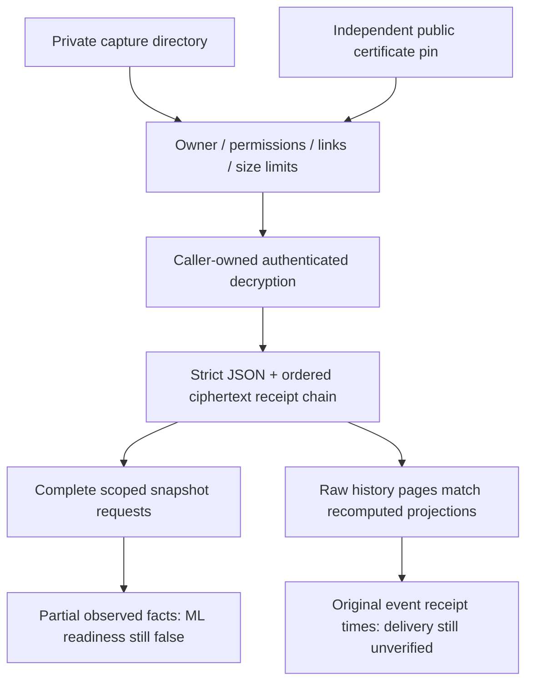

# Private capture ingestion

`research/archive_ingestion.py` validates private encrypted capture directories and their decoded record chains before invoking the snapshot adapter or exposing history envelopes. It makes no AWS call and writes no plaintext. Production decryption is deliberately supplied by a caller-owned trusted callback; this module never reads a private key, asks for a password or prints decrypted content. The callback must authenticate CMS content before returning plaintext bytes and must not log sensitive errors. Tests use actual CMS encryption/decryption with ephemeral synthetic recipients, not real user keys.

## Storage and receipt checks

On the supported POSIX host, the capture directory and every file must be owned by the current user and inaccessible to group/other users. Root and file descriptors use no-follow flags; file reads additionally reject nonregular files, hardlinks and detected concurrent changes. Nonblocking opens avoid hanging on substituted FIFO entries. Only the normalized public certificate and a contiguous sequence of canonical record filenames are accepted. Missing, renamed or extra files fail.

The public PEM certificate's file hash must match an independently supplied trusted pin. Obtaining the expected hash from the same untrusted archive would defeat that substitution check. The pin identifies the normalized public PEM file, not a private key or an X.509 chain validation. Historical archives do not fail merely because a certificate has since expired.

Default limits are 10,000 records and 64 MiB cumulative encoded certificate/ciphertext/plaintext bytes, adjustable explicitly by the caller. These are byte-count bounds, not a guarantee of total Python object memory or trusted-callback runtime. The decryption boundary itself must enforce appropriate resource limits.

Decoded outer envelopes reject duplicate JSON keys and nonfinite numeric constants. The final encrypted completion marker must list the filename/hash of every preceding ciphertext in exact order. Its own ciphertext hash contributes to the returned archive fingerprint. An incomplete capture, mismatched receipt list, wrong reader identity or non-development completion cannot proceed.

## Scope and source binding

Snapshots must include every maintained required request, either a response or one of the explicit optional S3-absence codes. Errors and truncation cannot be disguised by setting complete=true. The adapter independently checks exact request parameters, bucket guards and reader identity. Source statuses remain separate, missing technical facts stay unknown, and numerical ML readiness is not inferred.

History captures must retain an explicit selected bucket in their scope record. The collector now writes that field so even an empty result remains bound to the selected bucket. The verifier rechecks location/project guards, raw/projection record pairs, all five mutation operations, one consistent interval and terminal counts. It recomputes each scoped projection from its retained raw SDK-visible page and preserves original receipt timestamps. Old history formats without explicit retained scope fail rather than guessing a bucket. No real captures requiring migration exist from this change.

## What verification does not establish

CMS public-recipient encryption and receipt hashes do not authenticate the capture author. Someone with the public certificate can fabricate an entirely new internally consistent archive. The verifier explicitly returns sender_authenticated=false. This is corruption/substitution and source-consistency checking, not a digital signature or an independent audit of the machine/provider.

A valid record chain does not establish delivery completeness, continuous interval protection, verified trigger timing, independent ground truth or formal-run permission. History inspection still reports delivery_verified=false and primary_trial_ready=false; the verifier rejects an attempt to promote those flags. Formal trial authorization remains false. Ground-truth labels are never joined here.

The result includes decoded records for an in-memory consumer; callers must not print, commit, or export them as plaintext. Raw files, exact certificates, fingerprints selected for real captures and administrative reviews stay private. There is no production private-key integration, live capture, model training, IAM change or monitoring activation in this code change.
