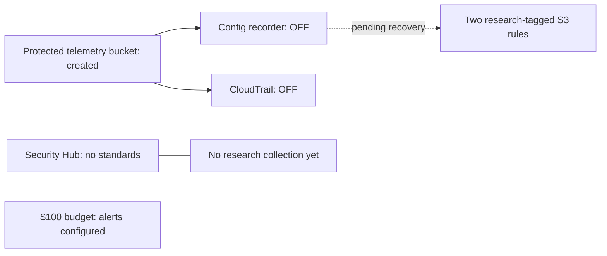

# Paused baseline recovery: two missing Config rules

PR #7 was merged and the approved saved baseline plan was applied under the bounded role. The apply partially succeeded: 14 Terraform objects were created, while both Config rule creates failed with `InvalidParameterValueException: Scope cannot be applied to both resource and tag`. Terraform retained the partial deployment in isolated remote baseline state; no rollback or state removal was performed.

## Current verified status

- Telemetry bucket: versioning, AES256 encryption, SSE-C blocking, all four public-access-block settings, bucket-owner-enforced ownership, and non-public policy status verified.
- Config recorder exists and reports recording false; delivery channel exists; neither direct Config rule exists yet.
- CloudTrail exists and reports IsLogging false.
- Security Hub CSPM is enrolled with AutoEnableControls false and no enabled standards.
- Monthly budget is $100. Actual thresholds are 50/80/100 percent and forecast threshold is 100 percent, each configured with the privately supplied email recipient. Subscriber configuration was verified; actual notification delivery has not been demonstrated.

## Correction and regression coverage

AWS Config scope accepts a resource-type filter or a tag key/value filter; combining the two was rejected by the live service. Remove the resource-type field from each rule's scope, retaining `Project=aws-ai-compliance-dissertation`. Their AWS-managed source identifiers remain S3-specific, and the recorder still includes only AWS::S3::Bucket. No IAM, recorder, tagging or permissions-boundary changes are proposed.

The existing scope regression now verifies that the recorder remains S3-only, both rule scopes retain the exact research tag, and neither rule scope includes the incompatible resource-type list. Terraform validation and all seven mocked baseline runs pass. The earlier offline test did not catch the service restriction; this correction does not claim live rule creation has succeeded.

References: [Config Scope API](https://docs.aws.amazon.com/config/latest/APIReference/API_Scope.html), [TLS-only S3 managed rule](https://docs.aws.amazon.com/config/latest/developerguide/s3-bucket-ssl-requests-only.html).

## Exact recovery plan and approval

Saved remote-backend plan SHA-256: `e1b2bf5cd60c9a466a59fbde37446ee118d6b29a0239dda8e03cd7d61ebd45d2`.

Only two creates are proposed:

- `aws_config_config_rule.s3["public_access_blocks"]`
- `aws_config_config_rule.s3["tls_required"]`

There are zero updates, replacements or deletions. Recording and logging stay off; no standard is subscribed and no permissions are changed. Prices and the existing $100 alert budget are unchanged. Service initialization or evaluation can still incur charges; alert thresholds do not cap spending.

The original approval applies to its original saved plan. Per `paused-baseline-approval.md`, a replacement plan needs a new explicit approval; no recovery apply has occurred. After approval, apply only this saved plan, verify both live rule scopes, recheck paused collection and require a no-change resource plan. Do not reuse the partially applied original plan.

Pilot and confirmatory collection remain unstarted. This deployment is not yet a validated research instrument.
