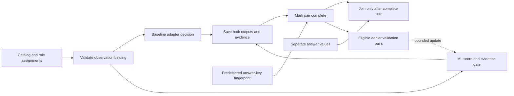

# Connecting the ML pipeline to paired evidence

PR #10 is merged. The next offline layer now binds the real Isolation Forest prototype to declared scenarios, retained learning assignments and paired prediction files. Every new function explains its purpose, inputs and outputs, and important logic blocks have intent comments. No AWS resources, monitoring settings or permissions change here.



## Inputs and outputs

`DevelopmentController` accepts a new private output directory, a source-locked S3 development catalog, its complete assignment manifest, an opaque predeclared ground-truth hash, and optional ML settings. It receives no expected-answer values. It retains a checksummed design record without labels. The model still receives only its allowed numeric inputs and observed technical facts.

Every observation arrives as a scenario ID plus the existing ML observation schema. Before training, calibration or scoring, the controller verifies the scenario, assigned learning role, overlap group and completed development status. Caller-provided role/group values cannot override the manifest. The controller supports declared S3 mapping targets only; the new `technical_mapping_target` field explicitly connects each draft family to a fixed mapping. The catalog content hash changes accordingly, so old assignments must not be reused.

The baseline adapter supplies an explicit outcome, source version and exact observation hash. It must match the AI input evidence identity. This is an adapter contract, not an implemented AWS findings collector or a final Config/Security Hub fusion policy. The synthetic demo uses an explicit unknown baseline and never fabricates an AWS finding.

A new pair reserves its own directory, saves the observed input, writes both immutable prediction receipts, retains AI score/threshold/version details, then writes a checksummed complete status. Reusing the trial ID fails. Complete means both outputs were retained; it does not establish scientific trial validity. Unknowns and instrumentation-failure results remain explicit. Partial write failures retain existing files and mark the pair incomplete where the filesystem permits; evaluation and adaptation fail closed when a complete status is absent.

`evaluate_pair` receives the separate expected-answer file only at the evaluation boundary. It validates its schema/version and predeclared content hash, the original design, complete pair status, recorded observation identity, both receipts and AI score metadata. A balanced but changed answer key is rejected instead of allowing post-hoc relabeling. Evaluation writes a new checksummed record once and retains unknown outcomes; it calculates no accuracy, exclusions or inferential metrics yet.

## Adaptation and model retention

The controller permits adaptation only from assigned validation/adaptation observations whose original evidence and both matching receipts are retained in a complete pair. Instrument-failure pairs are ineligible. The existing ML layer additionally enforces earlier completed batches, saved AI decisions, no held-out or fitted/anchor reuse, clean technical state, update size/fraction, pool size, threshold movement, schedule/count limits and anchor-drift rollback.

The initial fitted model and every successfully retained accepted update have separate version directories under `models/`. If a candidate model is rejected, the ML layer preserves the active model as before. If an accepted update cannot save its fitted artifact, the controller blocks further pair execution/adaptation; it does not pretend the artifact exists or silently continue. The in-memory model may already have changed at that point, so this is a procedural persistence failure requiring investigation, not a successful update or automatic rollback. No artifact recovery or overwrite mechanism is implemented here.

Checksums establish content consistency, not authentication against someone who deliberately rewrites data and hashes. Process/access isolation, scientific release authorization and a frozen-catalog formal controller remain future work.

## Synthetic integration demonstration

```sh
python scripts/check_function_docs.py
python -m unittest discover -s tests -v
python scripts/controller_smoke.py --output evidence/new-controller-smoke
```

The demonstration fits an actual forest, commits eight paired validation observations, accepts one bounded update, commits one held-out synthetic pair and joins its separate expected answer. It writes initial/adapted fitted artifacts and explicitly records synthetic_only=true, zero AWS calls and zero research trials. No performance improvement, study sample size or research result is inferred.

For these wiring tests only, `synthetic_design()` creates visibly marked artificial independence groups in memory. It never writes them back to the real catalog. The real S3 draft still has one conservative overlap group, insufficient for independent training/calibration/held-out assignments. Artificial test groups do not solve that methodological limitation, and the source catalog remains blocked from formal freezing. The full six-service catalog, verified NIST assessments and independent review are still required.

## Remaining boundaries

This is a completed-observation offline controller, not a real-time experiment scheduler. A separate offline timing ledger now checks declared timestamps, attribution and fixed-window censoring; see `timing-and-censoring.md`. This completed-observation controller is not yet wired to live receipt timestamps and cannot establish actual common cutoffs, cloud trigger/closure/completeness, synchronized clocks, injection/restoration or delivery. Live baseline collectors, final result fusion, the unknown-compliant denominator policy, power simulations and R analyses remain pending. Pilot/confirmatory writing and all AWS collection stay disabled.
