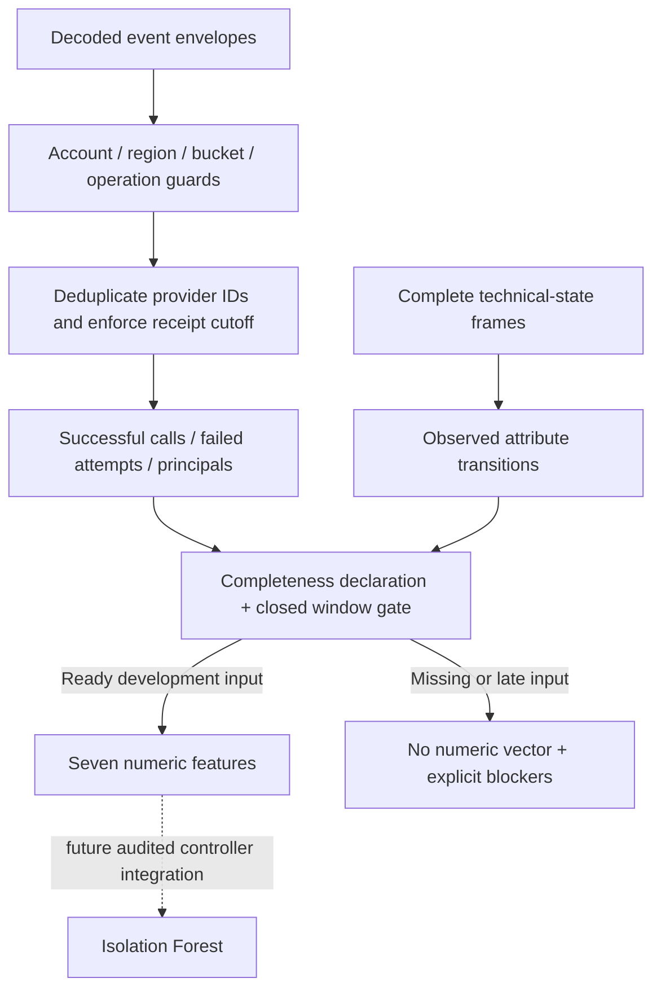

# Development S3 event features

`research/event_features.py` turns in-memory CloudTrail-shaped event envelopes plus complete technical-state frames into proposed numeric ML inputs. It makes no AWS calls, changes no permissions, writes no files, and fits no model. This module is not a live event collector and does not establish provider delivery completeness.

## Proposed feature meanings

Only PutBucketPolicy, DeleteBucketPolicy, PutBucketPublicAccessBlock, DeleteBucketPublicAccessBlock and PutBucketVersioning management API calls are eligible. Counts refer to successful API requests, not proof that each request changed effective state. Polling reads, object/data events and all other operation names are outside this draft feature definition. Features do not encode expected answers or scenario fault labels.

| Model input | Definition in this draft |
| --- | --- |
| mutation_count | Successful eligible API calls. |
| policy_change_count | Successful eligible policy put/delete calls. |
| public_access_change_count | Successful eligible public-access-block put/delete calls. |
| versioning_change_count | Successful eligible versioning calls. |
| principal_count | Distinct nonempty CloudTrail principalId strings among eligible attempts, including failed attempts. Assumed-role sessions can therefore count separately. |
| configuration_delta_count | Number of changed boolean attributes between adjacent retained state frames. Not a count of all underlying mutations. |
| failed_request_fraction | Eligible attempts with top-level errorCode divided by all eligible attempts. Zero only for a declared complete quiet window; absent history never implies zero. |

The seven field names match the existing model validator. `EXTRACTION_VERSION` separately identifies these newly proposed meanings; numeric compatibility alone does not authorize reusing older fitted models. Initial model/anchor inputs must be rebuilt consistently and the extraction version/source hashes retained in the eventual controller audit before actual integration. No model was trained or reused by this change.

## Scope and availability

Coverage must name the reviewed account, Ohio region and one of the two research buckets. It must declare development phase, a closed 1,800-second interval, the source-manifest hash and explicit booleans for complete pages, verified delivery and complete scheduled snapshots. Extra coverage fields such as expected labels are rejected. These assertions are declarations, not cryptographic or cloud attestations: a fabricated true value cannot establish real completeness. The future collector must substantiate them, and this function does not admit formal study inputs.

Each event envelope contains only `event` and `collector_recorded_at`. Eligible events must identify the recipient account, endpoint region, exact requestParameters.bucketName, provider eventID, event time, principalId, Management category, managementEvent=true, readOnly=false and AwsApiCall type. Unattributable relevant events block the vector. Wrong account/region/bucket and explicitly out-of-window events are counted as ignored. Missing required event clocks raise; inferred timestamps are forbidden.

Events must have occurred within the inclusive window and been received by its cutoff. An in-window event delivered afterward blocks extraction rather than improving the result retrospectively. Identical eventID/body pairs are deduplicated using the earliest receipt; conflicting bodies fail. Duplicate receipt order cannot change feature values. Receipt times before event times or after declared closure fail. Unsupported nested error layouts and error messages without codes block extraction. Top-level errorCode is the supported S3 error layout, not a universal rule for every AWS service. See [CloudTrail record contents](https://docs.aws.amazon.com/awscloudtrail/latest/userguide/cloudtrail-event-reference-record-contents.html).

## State-frame requirements and limitations

Frames have `observed_at`, `collector_recorded_at` and six unprefixed booleans: the four bucket public-access-block flags, versioning_enabled and tls_deny_present. This differs from the snapshot adapter's start/middle/end-prefixed fact keys. Conversion and archive/source binding remain future audited integration work; arbitrary expected state must never be passed as observed state.

The current strict development contract requires frames at both exact declared endpoints, received no later than the cutoff, with every fact known. Missing endpoints/facts block extraction; same-time conflicting frames fail. These exact-endpoint requirements have only been tested synthetically and need feasibility review before a live schedule is designed. They are not evidence that real snapshots can meet zero-delay endpoint timing.

Intermediate observed transitions count, including change followed by restoration when a middle frame captures it. Changes between frames can be missed. A completeness declaration describes scheduled samples, not continuous state protection; interval-wide compliance still requires independent trigger/telemetry validation.

## What remains

Separate bounded event-history collection, encrypted archive verification and Keychain-backed decryption are now implemented; see the event-history and archive-ingestion documents. The approved reader can query regional management-event history, with resource filtering performed by the application. This does not establish provider delivery completeness or integrate those captures into model inputs. CloudTrail logging is now approved and on; Config recording and CSPM standards remain off. Independent delivery/completeness evidence, feasible sampling/trigger timing and pairing these source hashes with retained controller/model artifacts remain pending. See the [prospective instrument review](prospective-instrument-review.md). Pilot and confirmatory paths remain disabled.
