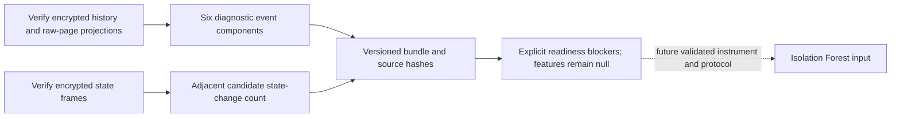

# Verified development feature-component bundle

`research/feature_bundle.py` joins one independently pinned encrypted history archive with ordered pinned snapshot archives. It produces a source-bound audit of the seven proposed feature components. It does not release a model input, train/adapt a model, change AWS or authorize a capture. Tests use genuine encryption with synthetic evidence only.

## Interface and binding

`build_feature_bundle(history_source, frame_sources, decrypt_record, recipient_sha256, bucket, window, max_acquisition_span_seconds, max_receipt_gap_seconds)` takes a history root/archive-hash binding, ordered state-frame bindings, trusted authenticated decryption callback, independently reviewed certificate/bucket scope and explicit timing settings. The exact window fields are phase=development, proposal_sha256, window_start, window_end and closed_at. The proposal fingerprint must match the source-locked study; the interval is exactly 1,800 seconds and administrative closure cannot precede its end. Labels, formal phases, readiness overrides and extra source/window fields fail.

History is reverified against its independently supplied pin, full ciphertext chain, scope and recomputed raw/projection bindings. Its exact interval must match the declared feature interval after timezone normalization. Snapshot sources are rebuilt and compared by the existing verified frame pipeline. Source pins must come from an independently trusted retained review, not just from the untrusted files being checked. Encryption and hashes do not authenticate the capture author.

The bundle fingerprint binds the history archive, complete state-comparison fingerprint, proposal/window, certificate and bucket. The comparison fingerprint transitively binds frame identities, source pins, acquisition spans, receipt-gap settings and cutoff. Reports include normalized facts/counts and private capture identities; callers must keep them private. No raw service bodies, archive paths, key material or plaintext files are returned or written.

## Seven components, separate from a feature vector

The shared pure helper `count_event_inputs` retains the existing six event-count definitions: successful eligible mutations, policy calls, public-access calls, versioning calls, distinct attempted principal IDs and failed-attempt fraction. It preserves the existing scope, provider-ID deduplication/conflict, receipt-cutoff and error-layout behavior. The original exact-endpoint extractor now calls this same helper; its output schema, completeness/endpoint requirements, model feature version and behavior are unchanged.

The seventh component is the adjacent-frame candidate changed-attribute count. It remains null when the existing frame comparison or window checks block it. Source acquisitions beginning before this bundle's source window are explicitly flagged and cannot supply this candidate; a future pre-trigger-anchor policy needs separate review rather than silent inclusion.

Event counts in event_audit are partial diagnostics, not complete telemetry. If any event blocker exists or any retained history page arrived after cutoff, all six event candidate components are null. This applies even to empty late pages: no selected events is not proof of a complete quiet window. Pages or state facts recorded after declared administrative closure cause rejection rather than backdating. Evidence received after cutoff but before closure stays auditable and cannot improve the scoring input retrospectively.

## Readiness stays closed

candidate_components names the seven fields but is not an authorized seven-column vector. features is always null and ml_ready is always false. The bundle always retains provider_delivery_unverified, source_freshness_unverified, trigger_unverified, sampling_schedule_unbound and extractor_protocol_not_frozen, plus any source-specific timing/data blockers. Formal authorization, sender authentication and independent-ground-truth use also remain false. There is no caller boolean that can promote those gates.

Retrospective LookupEvents pages generally become available to this collector after the closed interval; the pipeline does not turn them into a prospective latency instrument. A synthetic test with all pages received exactly at cutoff checks inclusive algorithm boundaries only. It does not demonstrate that real sequential queries can meet that timing or establish provider completeness. AWS's reported trail/digest delivery alone also does not establish interval/event completeness.

The next work is to implement and validate the prospective sampling/trigger instrument, define an independent operational completeness/freshness contract, and review/version the combined extraction protocol before connecting it to model inference. Controller persistence, score-before-adapt, group-safe training/calibration splits and separate pilot/confirmatory gates remain required. This audit does not adjudicate scientific exclusions or claim AI performance.
