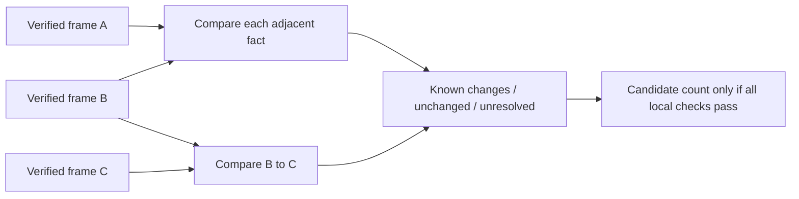

# Adjacent development state-frame comparisons

`research/frame_comparison.py` compares facts from separately timed, independently pinned encrypted snapshots. It prepares a candidate configuration-change component without altering the existing event-feature extractor, model, mapping or adaptation behavior. No AWS call, new capture, real-evidence processing or training is part of its synthetic validation.

## Interface and integrity

`compare_state_frames(sources, decrypt_record, recipient_sha256, bucket, cutoff_at, max_acquisition_span_seconds, max_receipt_gap_seconds)` accepts two through 1,000 explicitly ordered source bindings. Each contains only frame_id, root, archive_sha256 and record_pins. IDs are unique pseudonymous identifiers. Caller-supplied facts, clocks and expected labels are rejected. Each source is rebuilt through the existing state-frame/complete-archive verifier, using independently reviewed bucket/certificate/archive/record pins; the function does not trust a supplied frame success flag.

The three configuration reads retain their actual individual acquisition intervals. Sources are never sorted or silently deduplicated. Reused archives or fact-record hashes, duplicate IDs, overlapping/backward frame acquisitions and backward per-fact timing fail validation. Legacy missing request clocks stay explicit rather than being reconstructed. Public-recipient encryption and hashes still do not authenticate an author or prove provider completeness.

## Proposed count semantics

Each of the six boolean facts is compared only across adjacent frames, in the declared order. A known true-to-false or false-to-true transition contributes one candidate changed-attribute comparison. Equal known values contribute an unchanged comparison. These are observed attribute differences, not API mutation counts, inferred change times or evidence that the state remained constant between reads. A captured change followed by restoration contributes two transitions; a change/restoration entirely between acquisitions can be missed.

An unknown middle fact leaves both adjacent comparisons unresolved. The implementation does not bridge across it to compare known endpoints. Missing request timing, receipts after the explicit cutoff, excessive frame acquisition span or excessive per-fact receipt gap also leave comparisons unresolved. The receipt gap is measured from one fact's prior receipt to its next receipt; the caller supplies a whole-second bound from zero through 1,800 with no default. Equality at bounds passes. Test limits are synthetic illustrations, not approved live or scientific settings.

The report retains every rebuilt frame with its hash, per-fact before/after values, gap, changed=true/false/null and blockers. known_changed_comparisons and known_unchanged_comparisons are partial diagnostics; unresolved_comparisons stays separate. candidate_configuration_delta_count is null whenever any frame or comparison blocker exists. A zero candidate is returned only when all local checks pass and all adjacent known values match. Zero is not a compliance result or proof of continuous protection.

## Readiness boundary

The result includes a canonical input fingerprint binding frame IDs, rebuilt frame hashes and gap setting. Frame hashes transitively bind archive/record/bucket/certificate/cutoff/span settings. Reports contain facts and private capture identities, so callers must keep them private. No raw service bodies, archive paths, keys, labels or plaintext files are emitted.

local_comparison_checks_passed refers only to these local checks. Atomic-state establishment, source freshness, provider delivery verification, sender authentication, ML readiness and formal authorization remain false. This component is not a seven-column feature vector and does not replace configuration_delta_count in the existing strict extractor. New extraction semantics and training inputs must be reviewed/versioned together before any model reuse.

Remaining work includes binding the planned sample schedule and verified trigger/window, independent completeness/freshness evidence, event-history integration, persistence with the controller and model provenance, full group-safe catalog splits, pilot validation and separate formal authorization. Poor model outcomes must not be relabeled as instrumentation failures. Tests use genuine CMS encryption with synthetic true/false/restoration sequences, quiet windows, unknown middle facts, legacy timing, receipt/span/cutoff boundaries, source reuse and reordering.
