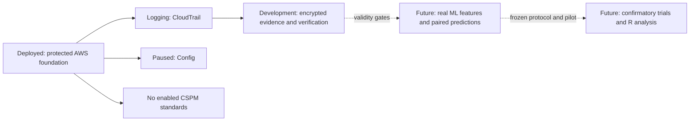

# Implementation plan and current completion boundary

The final proposal is the methodological source of truth. Its recorded SHA-256 is `99ad4b0aa5e1af82346f5e8b0bb1e8388b48726dc8815b8f68bddf3df896f5db`; [proposal traceability](proposal-traceability.md) identifies its requirements and open implementation decisions. This plan supersedes the initial October 26 setup assumptions. Historical deployment reviews describe their own approval scope, not new authorization.

## What is implemented

| Area | Current capability | Remaining boundary |
|---|---|---|
| AWS foundation | Version-controlled Terraform; separate protected state, deployment access, baseline and evidence-reader roots | Any further infrastructure or monitoring activation needs a reviewed plan |
| Monitoring | Approved CloudTrail-only development stage is logging | Config recording is paused; Security Hub CSPM has no enabled standards |
| Cost controls | $100 monthly account-wide alert budget with actual 50/80/100% and forecast 100% notifications configured | Email receipt is unproven; alerts do not cap spending |
| Evidence | Encrypted snapshot/history collectors; private receipt chains; dedicated local Keychain decryption helper; source and timing verification | Trigger, telemetry freshness, delivery completeness and formal paired monitoring remain unvalidated |
| Prospective instrument | Fixed-horizon native runner with bounded reader workers and offline journal/source replay | A development capture does not establish pilot or confirmatory readiness |
| AI/ML | Local Isolation Forest prototype, seven proposed features, bounded adaptation, deterministic evidence-gated mapping and score-before-adapt protections | No study model has been trained; real feature release remains blocked by missing validity and independence requirements |
| Scenario catalog | Twelve balanced draft S3 cases, independently specified expected answers, family/overlap checks and guarded freeze | Six-service coverage, source/assessment validation, viable independent splits and external review remain incomplete |
| Analysis | Paired prediction/timing contracts and explicit handling of missing evidence and non-detections | R runtime, power simulations and inferential analysis are not implemented; no minimum sample size is established |

No pilot or confirmatory research trials have been collected. Synthetic engineering fixtures and actual development captures remain separate from both research phases. Software checks cannot be reported as empirical accuracy, latency improvement or achieved statistical power.

## Next work, in dependency order

1. The approved development capture has closed: three snapshots verified, no failed or skipped samples, and the acquisition schedule passed. No plaintext evidence was exported and zero research trials ran. For any further approved capture, close and verify the attempt. Retain the independent approval, resolved schedule, ciphertext receipt and encrypted verification report. Report acquisition failures/skips honestly without converting them into research exclusions or classifications. Do not automatically retry a one-shot capture.
2. The [dedicated sandbox scaffold and trigger/restoration review](scenario-sandbox-review.md) now specify the next isolated development resource; creation defaults off; the [separate bounded-role access plan](sandbox-access-review.md) is prepared but unapplied, and bucket deployment approval remains pending. Complete prospective evidence validity: observable trigger and attribution, source availability/freshness, shared cutoff and restoration checks. Snapshot timing alone cannot establish event delivery or window-wide state. Further live reads or mutations require their own reviewed scope when outside existing approval.
3. Expand the independently authored catalog to EC2, S3, Lambda, EKS, VPC and IAM. Verify authoritative sources and assessment mappings, preserve balanced strata/labels, and establish enough defensible overlap groups for disjoint training, validation/adaptation and held-out roles. Freeze and hash before pilot; obtain independent AWS-security review before confirmatory collection.
4. Prespecify baseline fusion, unknown-compliant metric treatment, clock policy, technical invalidations, feature extraction and adaptation settings. Preserve unknowns and poor outcomes; do not choose policies after seeing confirmatory comparisons.
5. Implement and lock the R analysis environment and synthetic-data checks. Four binomial logit mixed models retain approach and scenario clustering. The latency comparison uses paired, clustered restricted mean time through 1,800 seconds. Retain all five tests in the Holm family. Missing data and failed fits must remain visible.
6. Run the proposal's power simulations before confirmatory collection: at least 1,000 datasets per candidate design, target power at least .80, familywise alpha .05, initial binary odds ratio 1.50, separate latency verification at 120 seconds and 15% censoring, with the specified sensitivity ranges. Retain seeds, distributions, design sizes, fit failures and Monte Carlo uncertainty. Select the larger binary/latency requirement; `[N]` remains unresolved until computed.
7. Review and approve activation and pilot plans with applicable baseline controls, costs, safe injection/restoration, evidence retention and stop/recovery procedures. Validate instruments using pilot evidence that cannot be promoted into confirmatory results. Repeat affected pilots after protocol changes.
8. Freeze the complete confirmatory protocol and sample size, then request approval for the exact collection plan. Persist both monitor outputs before joining the separately retained expected answers. Prepare the paper from retained observations and documented limitations.

## Permissions, state and deployment gates

Use profile `dissertation`, account `653464153304`, region `us-east-2`, and verify the actual non-root identity before AWS work. Native collection uses the existing bounded evidence-reader role and short-lived in-memory sessions. Do not widen access, use root or fall back to the provisioning identity when a reader operation fails. Keep credentials out of chat, source and backend configuration.

Preserve unrelated resources. Use dedicated research names/tags and separate protected S3 state keys and locks for bootstrap, access, baseline, reader access and later research phases. Versioning, private access, encryption, TLS enforcement and retention protect state/evidence. Do not create public resources or weaken protections merely to manufacture a scenario.

Merging software does not authorize an AWS apply, monitoring activation, scenario injection or live research run. Each new reviewed live plan must identify the actual account/role, exact resource/action scope, existing-service disposition, costs and duration, immutable plan/scope hashes, state recovery, evidence handling and teardown/restoration. Changed plans need renewed review. Existing CloudTrail logging continues independently of a local login session.

The $100 budget is an alert threshold, not a spending ceiling or an estimate. Avoid unnecessary compute, broad recording, data events, paid queries and idle EKS resources; cost and approve required study services explicitly. Preserve evidence during shutdown. Notification configuration does not demonstrate email delivery.

Private approvals, saved Terraform plans/state, inventories, raw captures, recipient details and budget email remain outside Git. Public account/user identifiers are authorized; that does not authorize publishing raw security evidence or secrets. See [native capture](native-capture.md), [offline verification](native-verification.md), [AI/ML pipeline](ai-ml-pipeline.md) and [research design contracts](research-software-design.md).
