# Native read-only snapshot wrapper

`research/native_capture.py` connects the development scheduling engine to the existing encrypted snapshot collector through a bounded worker. `scripts/prospective_snapshot_worker.py` is its internal stdin-driven worker, not an interactive capture CLI. No capture runs on import, scope preparation or code merge. This implementation was tested with synthetic ciphertext and mocked SDK/collector calls, plus a real local sleeping-process timeout probe. No real snapshot was taken by those tests.

```mermaid
flowchart LR
  A[Approved plan and native scope pins] --> B[Exclusive private run directory]
  B --> J[CMS-encrypted journal]
  B --> W[Isolated timed snapshot worker]
  W --> I[Verify source IAM user]
  I --> R[In-memory evidence-reader role session]
  R --> S[Existing bounded metadata read plan]
  S --> C[CMS-encrypted snapshot]
  C --> F[Ciphertext fingerprint; contents still unverified]
  F --> J
  J --> E[Encrypted report after window closure]
```

## Preparing a concrete review

`native_scope(bucket, certificate, output_root, openssl, timeout_seconds, max_items, max_pages, max_snapshots)` reads local code/runtime files and normalizes a public certificate. It makes no AWS call and creates no output. The scope fixes account 653464153304, Ohio, source profile dissertation, the existing evidence-reader role, one maintained research bucket and its exact read-plan hash. It also binds the canonical absolute output root, normalized public recipient, Python/OpenSSL executable hashes, selected SDK versions, maintained Python sources and dependency lock inputs. The Python executable path preserves its virtual environment.

Limits are explicit: worker timeout 1–300 seconds, per-query items 1–1,000, pages 1–20, total distinct snapshots 1–1,000. The scope includes a derived per-snapshot logical service-call bound: source STS identity, reader AssumeRole, reader STS identity, and each maintained query with its page cap. HTTP retries and login-token refresh traffic are additional; this is not a total account usage or billing cap. Local scope certificate normalization has a 30-second timeout and 64 KiB input bound. Native journal crypto uses min(worker_timeout,30) seconds per OpenSSL invocation.

The exact plan must carry the scope's independently reviewed hash and exactly the same number of scheduled samples as max_snapshots. `run_native_capture` validates the runner plan and these bindings before reserving output. The independent human capture approval must cover the actual scope/code/runtime, schedule, output and recipient identities, read/cost bounds and failure handling. A hash calculated by an arbitrary caller is not proof of approval. Keep actual scope/plan manifests and fingerprints private. Code merge authorizes no live run.

Before an approved live invocation, verify actual AWS identity through AWS MCP and confirm the reviewed local runtime/profile is ready. The native API has no automatic sign-in, profile modification, IAM widening, service activation, object-body read or scenario mutation. Existing $100 budget alerts remain notifications, not a spending cutoff; any prospective run's request costs need their capture review.

## Private storage and native execution

`NativeSnapshotCallbacks` validates the scope against current local inputs, requires an owned private parent, and reserves a new mode-700 root through an exclusive directory creation. Existing roots are refused. It creates mode-700 samples/journal directories and validates RSA/CMS encryption before source credential resolution. Journal and snapshot records are mode-600 CMS ciphertext; public certificate copies are also mode 600. No raw response or scope manifest is exported as plaintext by the wrapper.

Each unique scheduled sample starts pinned Python with isolated imports and an absolute worker path. Its descriptor is passed through stdin, bounded to 64 KiB. Inherited AWS credential/profile/endpoint overrides and Python/dynamic-loader overrides are removed; SDK region/retry/metadata/endpoint-ignore settings are fixed and rechecked. Worker stdout and stderr are discarded at the OS level, with Python stream suppression around the existing collector as well. No active-window comparison, score or raw body is returned to the researcher.

The worker uses the existing local-login dissertation profile, refuses static-key/process/web-identity/role/SSO source configuration, and verifies the exact expected non-root IAM user/account with STS. It then creates a **separate in-memory** botocore profile for the existing evidence-reader role, with a 900-second session request and the configured regional/retry/time limits. It exports no credentials and writes no new AWS profile. Automatic SDK login refresh can still use the existing local login store. The existing collector verifies the actual reader identity and bucket location/project guards before further reads.

The same fixed snapshot plan, optional-absence handling, item/page bounds, SDK request timestamps and encrypted completion records remain in use. The wrapper adds no history query, S3 log-body permission, Config recording, CSPM subscription or cloud resource. Parent source/runtime/recipient bindings are checked before and after each successful worker. These checks detect changed local inputs; they are not OS attestation, a sandbox for hostile Python callbacks, package-file integrity proofs or protection against a compromised host. Injected clocks are for offline tests; an approved live driver must use real clocks and the reviewed default integrations.

## Timeouts, failures and fingerprints

The parent starts a separate POSIX process group. Worker timeout or cancellation kills that group, including OpenSSL children, and reaps the worker. Cancellation propagates. Timeouts and ordinary capture failures retain partial ciphertext and write encrypted generic failure metadata; there is no automatic retry. Fatal descriptor/source/scope/inventory failures raise CollectorAbort, which stops the runner without a healthy closure marker or later sample. Journal/crypto failures also stop further collection. The engine still retains actual timing; parent validation/encryption work is separately bounded and a worker limit is not an exact whole-callback deadline.

A successful worker exit plus a private contiguous ciphertext inventory yields the same archive fingerprint used by verify_archive. This parent fingerprint does **not** decrypt or validate the completion record, authenticate the writer, verify provider delivery or establish a valid scientific observation. Independent offline verification/decryption remains necessary before any source adapter admits records. Unknown/failed/late records must not become zero features or exclusions chosen from model outcomes.

The final native_run_report is encrypted after the scheduler closes and binds preceding ciphertext receipts. Failure/cancellation leaves no final native report; partial output is preserved and cannot be silently resumed. `run_native_capture` returns only the closed runner report and native-report ciphertext receipt. Neither contains raw AWS responses, but actual metadata remains private. The new journal has its own event types; the snapshot/history verifier is not a journal verifier, and the separate native journal/source verifier now checks those records; see native-verification.md.

## Current boundary and next step

The implementation now has native read-only worker and encrypted-journal callbacks. A separately approved one-shot development capture has completed with three verified snapshots, zero failed/skipped samples and a passing acquisition schedule. The independent approvals, receipt and encrypted verification report remain private. No plaintext evidence was exported and no research trial ran. Trigger verification, paired monitoring, source freshness, independent completeness, ML readiness and formal release remain unvalidated. The reference timestamp in the development schedule is not an observed scenario trigger. This wrapper performs no injection or restoration and does not train/adapt the Isolation Forest.

Further capture attempts require a new concrete private bounded review and explicit approval; the completed one-shot approval cannot be reused. Next instrument work is independent trigger/event-availability validation and a feasible frozen extraction contract. Full reviewed catalog/splits, baseline activation, prospective event timing, instrument pilot and separate confirmatory authorization remain required. Tests cover actual synthetic CMS composition, archive-compatible fingerprints, private/exclusive storage, scope changes, source identity/role metadata, environment filtering, failure/fatal outcomes, process-group timeout and crypto deadline forwarding. Every function documents purpose, inputs and outputs.

The [native journal/source verifier](native-verification.md) now independently replays completed encrypted runs and checks successful snapshot sources, retaining failed samples and closed readiness gates. A reviewed relative template can bind a deterministic launch-relative schedule before the trusted driver retains its resolved plan; this provides no automatic capture permission.
