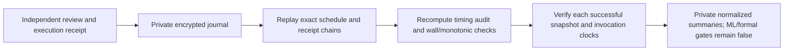

# Offline native run verification

`research/native_verification.py` verifies a completed native development run using an independently reviewed plan/scope, independently trusted public recipient pin and independently retained final ciphertext receipt. It decrypts through the caller's trusted callback in memory, makes no AWS call and writes no plaintext. The expected inputs must not simply be copied from the untrusted run being checked.

## Interface and completion checks

`verify_native_run(root, decrypt_record, recipient_sha256, native_report_sha256, plan, scope)` requires the original reviewed private run location, with only journal/samples directories. The shared `read_archive_records` helper preserves the original private-file, no-follow/no-hardlink, cumulative byte/record, strict-JSON and certificate checks. This refactor does not change snapshot/history completion semantics or their fingerprints.

The last ciphertext must match the externally retained native-report receipt, and its ordered predecessor filename/hash list must match every earlier journal file. The first decoded native_scope envelope must exactly match the independently supplied review. Formal/promoted/extra-field reports are refused. The verifier checks source account/region, recipient, read-plan hash, invocation count and runner scope binding. It does not require today's binaries to match historical code/runtime pins; it verifies the retained review identity rather than silently reinterpreting a changed read plan.

`verify_journal_sequence` replays the exact declared targets in order. It checks opened/due/skipped/failed/returned/closed event schemas, run/sample identity, target timestamps, eligible starts, skip reasons, ordered encrypted runner receipts and error pointers. Recorded wall/monotonic coordinates must be finite, ordered and within the reviewed drift bound. Actual closure cannot precede planned closure. The timing audit is rebuilt from actual invocation receipts and must match both the report and its closure hash. A cleanly closed schedule can still have a failed sampling audit; it is not a valid research trial merely because it closed.

The runner now retains monotonic coordinates for skipped targets too. Historical native formats without the required clock fields fail rather than being repaired. No real native captures predate this verifier. Existing older snapshot/history formats remain supported by their original adapters.

## Source verification

Every successful invocation must have an actual encrypted snapshot under its scheduled ID, with the exact fingerprint recorded in the runner receipt. The existing snapshot verifier rechecks reader identity, scope, required requests and encrypted completion. Non-paginated request starts and all response/optional-absence receipts must lie inside their outer collector invocation. Paginated page/item counts must respect the reviewed caps; duplicate non-paginated responses fail. The native verifier does not substitute callback timestamps for SDK request clocks.

Error invocations must point to their actual encrypted native/collector failure record. Failed partial sources are retained and listed separately, never admitted as successful snapshots. Native failure retention flags must agree with disk, and any retained partial directory must remain private/owned. Unknown extra sample outputs, missing final reports, changed ciphertext, substituted pins, extra labels/scores, source-clock mismatch or reordered events fail verification.

The result contains verified source fingerprints, normalized observations, recomputed sampling audit and failed/skipped IDs. These remain private; no raw bodies, paths, keys or ground truth are returned. Verification establishes internal byte/source/clock consistency under trusted execution receipts. Public-recipient encryption is not an author signature, and an adversary controlling both the run and the supposedly independent inputs can fabricate consistent data. Sender authentication, trigger/freshness/delivery verification, ML readiness and formal authorization remain false. This tool does not classify compliance, derive scientific exclusions/FNs or join answer labels.

Tests use genuine synthetic CMS runs and source archives, with altered pins/ciphertext, missing completion, wrong event identity, clock changes, extra labels and an explicitly failed snapshot. Real keys, captures and AWS APIs are not used. Independent instrument/pilot validation and full reviewed scientific protocol remain required.

## Relative review templates

`research/capture_template.py` resolves an explicitly approved relative development schedule before any collection. `resolve_native_plan(template, approved_template_sha256, reference_at)` accepts exact fixed offsets/tolerances, source/proposal/scope identity and an actual trusted launch reference. It returns a copied absolute runner plan plus template/reference/plan hashes. The fixed 1,800-second horizon never changes; the relative rule must leave a future pre-trigger target within the runner's launch bound. Labels, formal phases, changed approval pins and invalid timing bounds fail.

A human may approve this precise deterministic relative rule instead of an absolute schedule that becomes stale while awaiting approval. The trusted driver must retain the template approval and resolution **outside the run before executing it**, use real UTC launch time and verify the resolved plan is exactly the function's output. The native journal binds that resolved plan hash; offline verification takes it from the independent resolution artifact. This does not permit discretionary target changes, outcome-driven start selection, repeated runs or retries under the same approval. Hash matching is not evidence that a human actually approved either input. The reference timestamp still is not a verified AWS scenario trigger.
