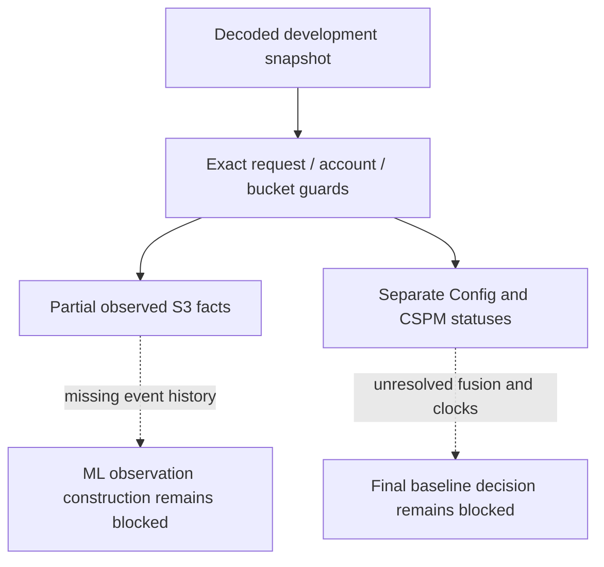

# Development snapshot observations

`research/observations.py` is a pure in-memory adapter for decoded collector envelopes. It makes no AWS calls, reads no answer key and writes no evidence. The input must already have crossed a trusted decryption/verification boundary. This adapter does not load private keys, decrypt CMS files, verify ciphertext receipts, authenticate a capture author or turn a completion declaration into proof of collection health.

The maintained read plan is the allowlist, including exact parameters. One verified-format reader identity must precede observations and one completion marker must close them. Successful location and Project-tag guards are required. Conflicting non-paginated responses are rejected rather than overwritten. Input and individual source-envelope hashes preserve content identity, not authenticity. Formal pilot/confirmatory input is rejected.

## Technical facts

The adapter exposes only observed booleans under an explicit `start`, `middle` or `end` slot. This slot is supplied by the caller and does not prove trigger timing, freshness or continuous interval protection. A single snapshot cannot establish that a protection stayed enabled throughout a trial.

- Public-access-block flags are emitted only when each returned value is an actual boolean. False stays false; missing/mistyped settings stay unknown.
- A successful versioning response with Status Enabled gives true; Suspended or the documented never-enabled response with no Status gives false. AccessDenied is not a successful empty response. See [S3 GetBucketVersioning](https://docs.aws.amazon.com/AmazonS3/latest/API/API_GetBucketVersioning.html).
- TLS policy inspection recognizes a deliberately narrow sufficient pattern: universal principal, Deny, all S3 actions, coverage of both the selected bucket and its objects, and only Bool aws:SecureTransport=false. A confirmed NoSuchBucketPolicy yields false for the specific bucket-policy predicate. Other policies remain unknown. This is not a general IAM evaluator or a complete assessment of all transport restrictions.

Optional absence, request errors, truncation and unsupported policy semantics have distinct audit entries. Missing source responses remain listed even if a capture declares completion. Observations never replace independently specified ground truth.

## Baseline source results

Config results are rechecked for exact bucket, resource type and requested rule name. CSPM V1/ASFF findings are rechecked for account, region, Security Hub product, ACTIVE record state, S3.5/S3.8 control ID and exact bucket resource/type. Unrelated returned items cannot become selected source results. Statuses such as PASSED, FAILED and INSUFFICIENT_DATA remain source statuses, not fused monitor predictions or percentages.

Config ordering and result-recorded times are retained separately. ASFF LastObservedAt and UpdatedAt are retained; UpdatedAt is not claimed to be first detection. Missing clocks remain null. Stale clocks are retained without being credited as detections. The adapter explicitly reports freshness_assessed=false and does not create timing-ledger events. A later validated clock adapter must establish attribution, ordering and the common window before timing analysis. Provider schemas and semantics are described by [Config EvaluationResult](https://docs.aws.amazon.com/config/latest/APIReference/API_EvaluationResult.html) and [ASFF finding format](https://docs.aws.amazon.com/securityhub/latest/userguide/securityhub-findings-format.html).

## Why ML readiness remains false

The current collector does not capture CloudTrail event history. Snapshots cannot establish the seven numeric ML inputs: mutation, policy-change, public-access-change, versioning-change, principal and configuration-delta counts, or failed-request fraction. Missing history must not become seven zero values. The adapter therefore emits no numeric feature vector and always reports ml_ready=false. It cannot feed the existing model/controller directly.

Next work includes a scoped event-history collector and completeness contract, feature extraction, trusted archive-to-adapter integration, real clock/trigger association and the final reviewed baseline-fusion rule. These are explicit gaps, not simulated results. No monitoring activation, live capture, model retraining or infrastructure changes occur in this change.
