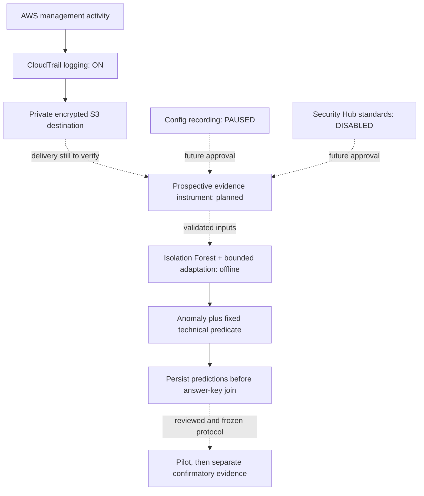

# Prospective instrument review

Historical activation status on October 27, 2026 (America/Chicago): approved CloudTrail-only activation applied. Config remains paused; no Security Hub CSPM standards are enabled. This document proposes the next development work, not an approved capture, scenario injection or frozen scientific protocol.

The approved permission and trail plans each changed one existing object. Initial read-only checks confirmed logging on, recording off and zero standards. The initial trail status had no delivery-attempt timestamp. Logging status alone does not prove delivery, complete telemetry, valid detection timing or model readiness. No log object bodies were read and no new local capture or scenario mutation was performed by activation.

Follow-up on October 28, 2026: after renewing the expired development sign-in, both AWS and GitHub MCP connections passed direct checks. AWS trail status reports successful log and digest delivery. Config still reports recording off and Security Hub reports zero enabled standards. These service-reported timestamps establish that delivery has occurred; they do not verify log contents, signatures, completeness, per-event arrival or research instrument validity. No object bodies were read by this check.

## Current development instrument status

On October 29, the separately approved one-shot native development capture closed and passed offline journal/source verification: three snapshots verified, zero failed/skipped samples, and acquisition timing passed. Approval, resolved schedule, ciphertext receipt and the encrypted full verification report remain private. No plaintext evidence was exported. The declared reference time was not a verified scenario trigger; delivery completeness, freshness, paired monitoring, ML readiness and formal authorization remain unvalidated. Zero research trials ran.

The native adapter and verifier are now implemented; the earlier planning descriptions below do not authorize another capture. See [native capture](native-capture.md), [verification](native-verification.md) and the updated [implementation plan](implementation-plan.md).

## Next development check to prepare

Use a new development-only run directory and review manifest; never append to the completed software-check capture. Bind the proposal/catalog/instrument versions, exact account/region/resource scope, identities, public recipient certificate fingerprint, operation allowlist, schedule, API/page caps and output permissions before collecting. Retain the approval and manifest fingerprint with the run. Keep pilot and confirmatory routes disabled.

The next review should first establish passive delivery using status and narrowly scoped delivery metadata. Any proposed object-body access needs separately reviewed permission and capture scope; the existing reader does not grant it. Retain negative/error results without declaring an empty lookup complete or compliant. Do not manufacture a mutation merely to obtain a delivery timestamp.

After passive delivery is established, prepare a separate, bounded trigger/sampling feasibility check on an explicitly approved research resource. Specify pre-state, exact mutation and restoration, attributable independent trigger evidence, maximum duration/calls, error handling and recovery verification. A successful API response alone must not become a verified observable trigger. Do not use expected answers to construct observed facts.

## Timing problem to resolve before integration

The current feature extractor requires state frames at both exact window endpoints, received by the cutoff. That is a synthetic contract, not a feasible live scheduler. Do not pad timestamps, backdate late responses, move the shared 1,800-second horizon or set completeness flags merely to satisfy it.

The separate [development sampling audit](sampling-contract.md) now retains scheduled targets, request starts, receipts, optional source clocks and late/missing/error blockers. It distinguishes a pre-trigger anchor from in-window acquisitions without interpreting facts or replacing the extractor. Clock uncertainty and failed requests must be retained rather than assigned invented observation times. Before any replacement extractor is used, specify admissible anchor age, scheduling tolerance, closure/grace behavior and treatment of incomplete frames; test their boundary cases offline and review them before capture. These numerical choices are unresolved, not selected from observed comparative outcomes.

The [development callback runner](prospective-runner.md) now executes those targets under virtual-clock tests, preserving missed targets and the fixed cutoff. It requires trusted collector/journal/clock callbacks and approved plan/scope fingerprints; the engine itself does not verify a cloud trigger. The separate native adapter now supplies bounded live read-only workers and encrypted journaling, with independent post-closure verification. Invocation clocks are not substituted for individual AWS request clocks. No new capture is authorized by this scheduling implementation.

For the existing proposed collector-recorded primary clock, late evidence stays auditable but cannot retroactively earn an in-window detection. A later administrative closure may retain late delivery; it must not extend detection eligibility. Retrospective LookupEvents pagination is not evidence of complete provider delivery. Absence of a violation finding is not proof of compliance. Preserve these distinctions when defining a feasible sampling contract.

## Remaining research gates

| Work | Current boundary | Completion needed |
| --- | --- | --- |
| Telemetry | Trail logging on; log/digest delivery reported; event completeness unverified | Delivery and clock evidence, prospective sampling/trigger validation |
| Baseline | Config paused; CSPM standards disabled | Reviewed permission/cost plans, activation, fixed applicable controls and validation |
| Catalog | Initial S3 candidates; related candidates overlap | Six-service independent sourced catalog, balanced families/labels, group-safe splits, review and freeze |
| AI/ML | Tested offline Isolation Forest, adaptation and deterministic mapping | Valid training/anchor inputs, extractor/controller integration, retained model provenance and leakage checks |
| Outcomes | Offline timing and answer-join protections | Prespecified baseline fusion, unknown-compliant denominator, clock/quality policy |
| Analysis | Proposal requirements traced | Locked R environment, paired/clustered power simulations and five-outcome analysis |
| Study | Zero pilot/confirmatory trials | Catalog freeze, instrument pilot, independent review and separate confirmatory authorization |

The $100 account-wide budget is an alert, not a spending cutoff. CloudTrail continues until an approved pause; credential expiry does not stop it. Existing logs and retention remain after stopping. Keep active-stage inputs private and explicit in future live plans. Code merges alone authorize neither activation changes nor live capture.
