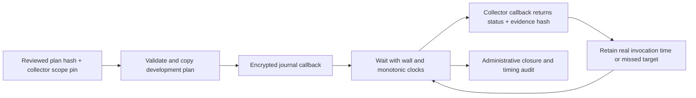

# Development prospective scheduling runner

`research/prospective_runner.py` provides a callback scheduling engine, tested with virtual clocks. It has no AWS client, default collector, live CLI, credential lookup, scenario injection, model invocation or restoration action. Nothing runs on import or construction. No real capture or deployment accompanies this change.

The hash-verified final proposal paragraphs P0848–P0860 and P0882–P0886 were reread for this implementation. They require an observable verified trigger, matched observation conditions, hidden determinations during the window, a fixed 1,800-second horizon and retained non-detections. This engine does not itself implement those complete scientific requirements. It preserves one declared reference horizon for future integration and always reports trigger_verified=false and paired_monitoring_validated=false.

## Explicit inputs and trust boundary

`DevelopmentSamplingRunner(plan, approved_plan_sha256, collect, persist, wall_clock, monotonic_clock, sleeper)` requires every dependency explicitly. The exact plan fields are phase=development, kind=development_sampling, proposal_sha256, run_id, collector_scope_sha256, sampling and max_clock_skew_seconds. The sampling object uses the existing development sampling schema with one pre-trigger anchor, ordered samples, a reference trigger timestamp, planned closure and explicit timing bounds. Ground-truth fields, formal phases and extra root plan fields are rejected. The plan is copied and checked again before execution.

The approved fingerprint must come from an independently trusted human-approved review; computing the hash of an arbitrary unreviewed plan is not authorization. The scope pin identifies a separately reviewed collector binding covering code version, profile/role, account, region, resource allowlist, operations/caps and public recipient identity. The engine validates/binds that hash but cannot inspect or prove that an arbitrary Python callback implements the scope. A future live wrapper must recompute and verify the actual binding, verify AWS identity, enforce private exclusive output paths and obtain explicit approval of the concrete capture plan. Merging this engine provides no capture approval.

collect(sample_id) is a trusted silent bounded callback returning exactly status=success/error and evidence_sha256. It must retain source data through the approved encrypted collector and return the source fingerprint, without scores, labels or raw responses. persist(record) is a trusted silent encrypted-journal callback returning the ciphertext SHA-256. Hash-shaped callback returns do not prove encryption, durable persistence or authorship; the future adapter must implement and verify those properties. Tests deliberately fake these callbacks and do not claim otherwise.

The engine prints no results and returns its report only after administrative closure. It rejects additional collector result fields. It cannot stop arbitrary callback code from printing, writing elsewhere or sending data; quiet, scoped callbacks are part of the trusted integration contract. The live adapter must suppress active-window outputs and ensure no researcher sees comparative determinations. This engine does not load an answer key or produce a classification.

## Scheduling, clocks and deadlines

The runner preserves the declared targets instead of shifting later samples to compensate for delays. Each wait is at most 60 seconds and uses a fixed monotonic reference plus timezone-aware wall time. Nonfinite/backward monotonic clocks, stalled sleep/clock progress and wall/monotonic divergence beyond the explicit bound abort the run. The development skew bound is limited to 60 seconds, planned administrative grace to 1,800 seconds, and launch to within 1,800 seconds before the first target. These guardrails and synthetic test tolerances are not a frozen scientific clock policy or proof of synchronized source clocks.

Journal persistence happens before each collection decision; its latency consumes the same start tolerance. Missed targets are retained as skipped/missing samples, not moved or replaced. Anchors are not started at or after the reference trigger. No collection starts after the fixed cutoff. A call that starts in time and returns late retains its actual return time and timing blockers. Callback exceptions create a generic collector_exception journal event without exception text or service bodies; their error receipts remain auditable. Persistence failures abort rather than allowing unrecorded later reads.

The engine cannot interrupt a running callback. A future live wrapper must enforce independent bounded subprocess/SDK timeouts and safe cancellation; it must not promise that this synchronous engine stops a hung call at the cutoff. A late return can move actual administrative closure later than planned, but never changes the fixed trigger+1,800-second cutoff. The timing audit is derived with the actual closure while retaining the original approved plan hash and planned closure separately. Late evidence is not backdated into eligibility or converted into a detected event at the endpoint.

Runner receipts reuse the sampling audit's request_started_at field for the **collector invocation**, not an individual AWS request or atomic snapshot. Individual request clocks must still come from verified snapshot records through the existing adapters. source_observed_at remains null. The journal retains wall/monotonic readings and ordered prior ciphertext receipts in its closure event. A closure marker means scheduling ended; acquisition_schedule_met can still be false. An exception/interrupt has no normal closure marker and must not become a valid censored trial.

## Outputs and remaining work

run() is single-use per instance. It returns the pinned source/scope identities, planned and actual closure, original invocation receipts, missed sample IDs, derived timing audit and journal hashes. Private run metadata must remain outside Git. Recreating a Python instance is not a process-wide replay barrier: the future persistence adapter must use exclusive new run directories and refuse resume/replay without review.

Trigger verification, source freshness, delivery verification, sender authentication, paired-monitoring validation, ML readiness and formal authorization stay false. A reference trigger timestamp is a declaration, not proof that a scenario condition became observable. Missing samples and callback errors are development instrument observations, not automatic scientific exclusion/FN decisions. Pilot/confirmatory paths remain disabled.

Next integration work is the native read-only collector/encrypted-journal wrapper, independent trigger evidence validation and source/schedule binding. It must retain existing private capture safeguards, cap reads, handle partial outputs and prove restoration where future scenario injection is authorized. Full reviewed catalog/splits, paired live monitor outputs, randomized/counterbalanced scenario scheduling and formal readiness remain separate requirements. Virtual tests cover the full horizon without real sleeps, exact target starts, missed anchors, persistence latency, callback overruns/errors, source-output rejection, clock faults, replay and plan/scope/bound validation. Every function documents purpose, inputs and outputs.
