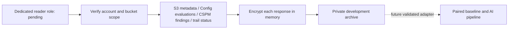

# Development snapshot collector

Status: offline tested software. The dedicated `dissertation-evidence-reader` role and public recipient certificate are prerequisites, not provisioned by this change. No live capture, monitoring activation or study trial is performed here. PR #12's timing ledger is a separate change; this snapshot does not implement timed polling.

The collector reads the two named research buckets only, one per run. It validates expected owner, Ohio location and the Project tag before reading resource observations. STS must identify the exact dedicated assumed role in account 653464153304; root, IAM users and the deployment role are rejected. This code does not create that role or change permissions. An independently reviewed IAM plan is required before configuring a reader profile. The existing `dissertation` profile remains unchanged.

The fixed request plan covers S3 location, tags, public access block, versioning, policy/status, encryption and ownership; Config recorder/status/delivery-channel context and both named rule evaluations; Security Hub CSPM V1 hub/standards context and active AWS Security Hub S3.5/S3.8 findings filtered by account, region and selected bucket ARN; and the named CloudTrail trail's status. Config context is regional and its named-rule evaluation responses can include other project buckets. Keep these raw pages private. Findings can include historical observations; no freshness/compliance conclusion is produced here.

No bucket objects, CloudTrail event bodies, state files, member accounts or unrelated buckets are enumerated or downloaded. No paid analytics query, service enablement, mutation, classification, training or Terraform operation occurs. Metadata reads can still contribute ordinary AWS request/management-event costs, so this PR does not authorize execution. Retries have three total attempts and short network timeouts. Each paginated operation has a maximum of 1,000 items; a remaining continuation token makes the capture incomplete. This is a bounded snapshot, not an exhaustive account audit.

Use `python scripts/collect_snapshot.py --plan` to review requests without credentials or cloud calls. A future authorized run additionally needs `--output` pointing to a new private directory and `--recipient-cert` pointing to an unexpired RSA public X.509 certificate (at least 3072 bits). The default profile is `dissertation-evidence-reader`. Do not pass passwords, private keys or access keys. Runtime dependencies are pinned in `requirements-aws.txt`; OpenSSL 3+ is required. The collector ignores configured endpoint overrides and uses the SDK's normal credential provider chain.

Responses and requests are serialized in memory and encrypted using OpenSSL CMS AES-256-GCM with RSA-OAEP/SHA-256. Each ciphertext is written exclusively with mode 600 under a new mode-700 directory; the only plaintext file is a public certificate copy. The collector never receives the recipient's private decryption key. Encryption authenticates content integrity, not the sender's identity. Raw evidence can still exist in process memory or operating-system memory facilities. Protect the machine and private decryption key separately.

Each response preserves AWS timestamps and a UTC collector receipt time. The final encrypted completion record references ciphertext hashes of preceding records. A crash or fatal error can leave partial ciphertext without a completion record; such a capture is incomplete and must not enter analysis. Existing output directories are never reused. Store all captures under ignored `evidence/`; never commit or publish raw/decrypted responses.

Absent optional S3 settings are explicit observations. AccessDenied, transport failure, truncation and missing monitoring remain distinct from a successful response. Empty findings or paused services never mean compliant. These snapshots do not provide independent ground truth, a verified trigger, a completed 1,800-second trial, ML features, or a baseline fusion decision. Those adapters require separate implementation and protocol review before pilot collection; pilot and confirmatory archives remain separate.

Verification uses SDK parameter models, stubbed pagination, scope/identity rejection and a temporary synthetic encryption/decryption fixture. No real AWS session is used by these tests.
