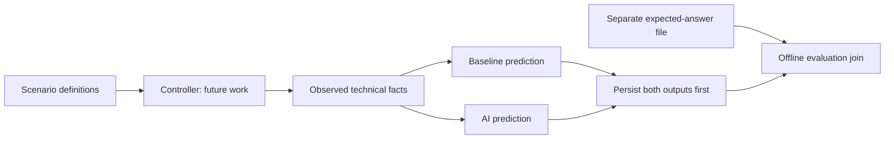

# Research design contracts: development only

The paused monitoring foundation is deployed, including both Config rules. The reviewed recovery succeeded and the final live resource plan reported no changes. The approved CloudTrail-only development stage is logging; Config recording remains paused and Security Hub has no standards enabled. The $100 monthly budget and four email alert subscriptions are configured; receipt has not been demonstrated. No research trials have run.

## What this change implements

- Twelve draft S3 scenario definitions and a separately stored expected-answer specification, derived from cited AWS control intent before any monitor outputs exist.
- Exact draft balance: three cases in each stratum-by-label cell. These counts describe a development design, not collected observations, achieved power, or a final sample size.
- Unique IDs, proposal/version linkage, source attribution, family and overlap-group validation, canonical content hashes and a freeze operation that refuses the incomplete draft.
- Seeded whole-overlap-group assignments. The current S3 cases share protections and conservatively belong to one overlap group. The three-way split therefore fails rather than putting similar examples into training and evaluation. The assignment algorithm is a proposed seeded group round-robin, not a final stratified sampling design. Inspect achieved service, stratum and label distributions before finalizing assignments.
- A label-free technical-input allowlist and immutable, checksummed paired prediction records. Evaluation joins require both predictions, matching scenario IDs, family, protocol and observation hashes. Unknown results remain unknown; no undocumented denominator or baseline-fusion choice is made.
- Orthogonal phase and learning-role metadata. The new prediction writer currently accepts development only; formal prediction writing is intentionally disabled until the frozen-catalog controller is integrated. The older generic `write_evidence` utility is a raw envelope writer, not authorization to run a trial.

**Ground truth** means the expected answer specified from the technical requirement before testing. It is not copied from Config, Security Hub or an AI prediction. Separate files and input allowlists reduce accidental leakage; they are not an operating-system security boundary. A future controller must enforce process/access isolation, verify trigger and restoration, and keep labels and injection specifications away from the monitor's feature pipeline.

## Development catalog scope and limits

The initial rule-matched candidates address explicit TLS-deny policy, all four bucket public-access-block settings, and versioning. The deployed baseline currently covers TLS and public-access-block instruments only. Versioning remains in the catalog despite absent deployed detection capability; do not drop it or silently enable additional baseline controls to improve measured coverage.

The proposed combinatorial/drift candidates combine protections or require retention throughout the observation window. Temporal cases include intermediate changes followed by restoration, so final-state snapshots alone cannot establish window-wide truth. Capturing those intermediate states and attributing them within 1,800 seconds remains unvalidated. No AWS mutations or unsafe exposure are implemented by these definitions.

Stratum labels are provisional: counts alone do not prove that a condition is genuinely combinatorial or lacks a single predefined rule. Source applicability, stratum assignment and technical ground truth require verification. NIST control IDs are **candidates**, not verified 800-53A determination statements or claims of full organizational compliance. Exact Release 5.2.0 assessment mappings remain pending.

The full proposal still requires EC2, Lambda, EKS, VPC and IAM in addition to S3. Full-catalog source/assessment verification and enough independently defensible overlap groups are required before freezing and hashing the catalog before pilot execution. An independent AWS-security reviewer must assess sources and balance before confirmatory collection. This code does not fabricate that review or authorize AWS activation.

## Files and checks

- `protocol/scenarios/development-s3-v0.1.json`: draft conditions, neutral IDs, external references, family/overlap grouping and review status; no labels.
- `protocol/ground-truth/development-s3-v0.1.json`: authored expected answers and required technical facts. These are design specifications, not observed evidence.
- `research/catalog.py`: balance/provenance checks, group assignments and guarded immutable freeze.
- `research/trials.py`: allowlisted inputs, development prediction storage and post-persistence evaluation join. Model/feature/mapping/adaptation versions are required metadata. An offline ML prototype and paired development controller now consume these contracts; see `ai-ml-pipeline.md` and `development-controller.md`.
- `scripts/audit_catalog.py`: offline balance/readiness report, included in CI. Draft readiness errors are reported, not hidden or treated as a passing formal-release gate.

Run `python3 scripts/audit_catalog.py`, `python3 scripts/check_function_docs.py` and `python3 -m unittest discover -s tests -v`. Tests use synthetic design fixtures; none contact AWS. Every function has a brief description.

The input facts are proposed booleans, not a frozen Isolation Forest feature schema. A development-only Isolation Forest, bounded adaptation and evidence-gated mapping are now implemented in `research/ml.py`; see `ai-ml-pipeline.md`. Encrypted real-source collectors, a native development scheduler and offline journal/source verification now exist. An integrated paired experiment controller, verified trigger/restoration, immutable formal-run authorization and R power/inferential analyses remain to implement. Do not interpret successful contract tests as empirical validation.

## Proposal traceability and next implementation

This work addresses M01–M03 and M10–M12 in `proposal-traceability.md`. The source DOCX in OneDrive timed out during this turn; its retained byte-for-byte cached copy was rehashed against the recorded final-proposal SHA-256 and the relevant source paragraphs were reread. The proposal and cached full text are not published.

Next expand and review the catalog across all six services, define executable state observations and the frozen feature/mapping/adaptation protocol, then integrate the offline model with the evidence controller. Baseline fusion, unknown-compliant denominators, power-based sample size and independent review remain explicit unresolved decisions. All AWS activation and further deployments still require a reviewed plan and approval.

Sources: [AWS S3 controls](https://docs.aws.amazon.com/securityhub/latest/userguide/s3-controls.html), [NIST SP 800-53A Rev. 5 and Release 5.2.0](https://csrc.nist.gov/pubs/sp/800/53/a/r5/final).
