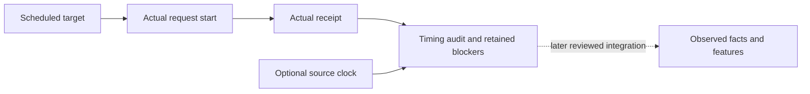

# Development acquisition timing audit

`research/sampling.py` adds an offline audit for a proposed schedule and actual request receipts. It runs no AWS calls, sleeps, injections, decryption or model inference. It does not replace the current feature extractor or freeze a live protocol. All functions explain their purpose, inputs and outputs.

## Inputs and outputs

`audit_sampling(plan, receipts)` takes an exact development plan with trigger/administrative-closure timestamps, explicitly chosen maximum request-start lateness, response duration and pre-trigger anchor age. Bounds are whole seconds from zero to 1,800; none has a default. The schedule contains between two and 1,000 uniquely named samples with ordered unique offsets, exactly one negative offset for the anchor, and the rest within the inclusive 1,800-second horizon. The bounds are proposed instrument settings requiring review, not approved scientific thresholds. Synthetic test tolerances are illustrations only.

Each receipt names one scheduled sample and retains request-start, collector-recorded and optional source-observed clocks, success/error status and source evidence SHA-256. A missing source clock stays null. A stale source clock stays in the audit with its age; acquisition success never proves source freshness. Inverted, naive or post-closure clocks, duplicate/unscheduled receipts, answer labels and extra schema fields fail validation. A hash binds content identity but does not authenticate its origin or establish an AWS observation.

The result retains the canonical plan hash, schedule, copied receipt fields, timing differences and explicit blockers. Missing samples, request errors, early/late starts, slow responses, stale/late anchors and post-horizon receipts block `acquisition_schedule_met`. Equality at configured bounds is accepted. This status describes acquisition timing only. `source_freshness_verified`, `provider_delivery_verified`, `ml_ready` and `formal_trial_authorized` always remain false.

The trigger timestamp is an input declaration, not trigger verification. Administrative closure may occur after the horizon to retain late evidence; it cannot extend the fixed detection cutoff. The anchor must be received by the trigger, within its proposed age limit. An in-window sample received after the horizon remains auditable and blocked. This module does not interpret technical-state facts, adjudicate scientific exclusions, determine monitor outcomes or silently turn unknowns into compliance.

## Integration boundary

The existing exact-endpoint feature contract remains unchanged. This audit provides a separate building block for a feasible instrument: it does not manufacture endpoint frames or relax completeness gates. A future reviewed integration must bind receipts to verified encrypted source archives and independent trigger evidence, validate source freshness/clock uncertainty, choose tolerances before comparative results, and define incomplete-frame handling. Retries need an explicit attempt contract; duplicate sample receipts are currently rejected rather than selecting the most favorable attempt.

The [verified snapshot receipt adapter](verified-sampling-receipts.md) now provides archive/record/request binding for one non-paginated operation. It preserves legacy timing gaps and does not solve independent trigger evidence, source freshness or multi-fact frame timing. No new capture or extractor integration accompanies that adapter.

Tests cover real response delays, preserved null/stale source clocks, missing/error samples, tolerance edges, pre-trigger anchors, late evidence, duplicate and inverted clocks, plan hashing, input preservation, strict schemas and rejection of formal phases. The module performs no file writes; the caller remains responsible for exclusive persistence and the existing approval gates before any live collection.
