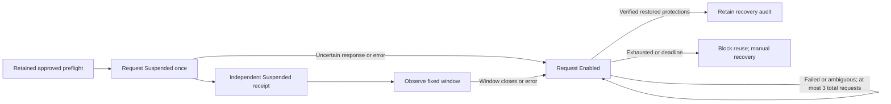

# Offline scenario recovery planner

`research/scenario_recovery.py` provides a pure decision table for the future dedicated S3 versioning runner. It makes no AWS calls and is not an executable scenario driver. All function inputs, outputs and side effects are documented.

The exact dedicated sandbox is fixed; other targets and invalid transitions fail closed. A write response alone directs recovery rather than starting an observation window. There is no second suspension request. Restoration requests are capped at three; cancellation or deadline during recovery blocks reuse and requires manual intervention. A successful restoration write alone is insufficient: the future runner must independently verify Enabled versioning and every preserved protection before supplying `restoration_verified`.

This module consumes caller-supplied event names, not authenticated cloud receipts. Frozen dataclasses prevent accidental mutation but do not prevent a caller from constructing new states or restarting a process. Persistent encrypted intent, exclusive locks, identity/owner checks, complete version/delete-marker/multipart emptiness checks, actual deadlines and credential coverage, independent trigger receipts, bounded collectors, recovery verification and a reviewed manual recovery procedure remain required before live use. The planner neither grants approval nor establishes a scientific trigger, exact timing, completeness or trial validity. No live runner imports it yet.

The three-request restoration ceiling is an initial software safety bound for review, not a frozen methodological choice or assurance of recovery. No pilot/confirmatory paths, model training or cloud activity are enabled. Tests use synthetic states and verify normal completion, uncertainty, exhausted recovery, terminal reuse rejection, scope checks and invalid-state rejection.
