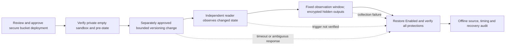

# Dedicated S3 development sandbox: implementation and review boundary

Status: Terraform scaffold and proposed workflow; the separate IAM access stage is deployed and verified, while the S3 bucket is not deployed. No bucket, role grant, mutation, capture or research trial is authorized by this document. The completed three-snapshot development check verified acquisition timing and encrypted source/journal consistency; it did not establish a cloud trigger or model readiness.

## Implemented scaffold

`infra/sandbox` reserves `dissertation-sandbox-653464153304-us-east-2-s3-01`. Its default `create_sandbox=false` requests no managed sandbox resources. Explicit creation additionally requires an independent review-manifest SHA-256 reference. That value records provenance; neither a syntactically valid hash nor a code merge proves human approval of a saved plan.

The provider requests the verified dedicated `dissertation-sandbox-deploy` role in account 653464153304, Ohio. It cannot fall back to the provisioning user. Actual role identity and default workspace are checked before bucket creation. The planned bucket has all four public-access blocks, owner-enforced ownership with ACLs disabled, explicit SSE-S3 encryption with SSE-C writes blocked, versioning Enabled and a TLS-deny-only policy. No object, public/service grant, compute, new KMS key, monitoring activation or scenario injector is created. Forced deletion is disabled and `prevent_destroy` requires a separately reviewed source change before Terraform can request bucket destruction. This is not an AWS deletion denial outside Terraform.

The backend source and its matching example use the protected state bucket, native locking and a unique `development-sandbox` key/prefix. The actual backend settings must be inspected during deployment review; the example alone cannot enforce state isolation. Never reuse baseline state or import a telemetry/state bucket as this sandbox.

**IAM deployment access is ready; bucket deployment is pending.** The dedicated deployment role was approved, created and verified through the [access review](sandbox-access-review.md). Existing baseline policies are unchanged; the evidence-reader allowlist still excludes this bucket. Existing collector `BUCKETS` guards also exclude the sandbox. The real protected-backend bucket plan is now prepared with six S3 creates and one Terraform guard, zero updates and zero deletes; explicit deployment approval remains pending. Reader/injector permissions, collector scope changes and separate live-run approval are required for later instrument work. No fake ARN, assumed access or unbounded-user fallback substitutes for them.

## Proposed trigger/restoration workflow — not executable yet

A later development-only feasibility check may use versioning `Enabled → Suspended → Enabled` on this dedicated empty bucket. It must not change TLS, public-access settings, encryption, ownership, telemetry storage or state storage. No object uploads/deletions are part of the proposed check. Suspending versioning is a temporary departure from the intended configuration and needs separate explicit approval; it is not authorized by deploying the secure scaffold.



The future driver must implement and test these requirements before a live review is offered:

1. Bind exact source/runtime/recipient versions, dedicated bucket/account/region, separate injector/reader identities, call/time/page caps and exclusive private output roots. Refuse state/log buckets, existing partial attempts, unknown tags or extra fields. Verify actual identity, bucket owner/location and retained protections. Establish that current objects, noncurrent versions, delete markers and multipart uploads are absent using complete bounded metadata listings; truncation or unknown emptiness blocks mutation. No object bodies may be read.
2. Persist encrypted pre-state and recovery intent before any write. Validate encryption and recovery credentials first. Specify credential lifetime/refresh and an outer deadline that leaves time for restoration; a 900-second single session cannot by itself cover a 1,800-second window plus recovery. Do not reuse the previous capture's approval, profile assumptions, scope pins or output root.
3. Retain mutation request/response clocks and AWS request identifiers, including ambiguous outcomes. Independently observe actual versioning state through the reader. A successful write response, planned timestamp or expected answer is not a verified observable trigger. Prespecify which observed receipt establishes the common clock and retain its uncertainty; do not choose or backdate the clock from later findings.
4. Keep the common 1,800-second horizon fixed after a verified trigger. Bound polling and journal persistence, hide live determinations, retain late/missing/error receipts and preserve non-detections. Initial bucket-versioning propagation and object-write concerns are documented by AWS; deployment and readiness checks must be separate from the observation clock. No object writes are proposed here.
5. Implement a prospective event-availability contract before any claim about event features or detection latency. CloudTrail request-ID/event attribution and actual collector availability must be retained if queried. A retrospective history lookup, empty page or trail delivery timestamp does not prove complete in-window event delivery. Current feature release remains blocked.
6. Restore the captured Enabled baseline on normal completion and on errors, including when the mutation response is ambiguous. Specify bounded idempotent restoration attempts separately from mutation retries. Verify actual Enabled state and every preserved protection after restoration. Keep failure evidence, block reuse on unverified recovery and present the exact scoped manual recovery action if automatic recovery fails. A local timeout alone is not proof of rollback.
7. Save both monitor outputs before any later answer join if a paired instrument is eventually enabled. This initial feasibility check has no formal predictions or trial outcomes. Versioning is currently outside the two deployed baseline-control candidates; do not silently add a versioning rule or drop the uncovered case to improve measured coverage.

IAM can restrict the injector to a named bucket and API, but the reviewed application must also enforce allowed versioning transitions, attempt limits and recovery. Do not claim that an IAM action grant alone constrains the requested versioning status or guarantees rollback. An execution lock is also required to prevent concurrent Terraform/controller changes while a future scenario is active. Terraform continues to declare Enabled and does not ignore drift; no Terraform apply should race the injector.

## Deployment review sequence

1. Inspect the actual non-root identity and existing role/state boundaries using read-only commands; verify the reserved name is not already owned/adopted. Obtain explicit disposition for any collision.
2. Prepare an independent private review manifest and isolated backend configuration. Generate a private saved Terraform plan/JSON under a reviewed planning identity. Do not use the provisioning user to apply around an access failure. Approve and verify the dedicated access plan first; do not substitute the provisioning user for the new role.
3. Use IAM Policy Autopilot on the actual plan JSON to generate required Terraform permissions. Retain its version, input/output hashes and warnings privately, then scope the action/resource ceiling and state-prefix permissions. Proposed command, once that plan exists:

   ```sh
   uvx iam-policy-autopilot@latest generate-policies \
     /absolute/private/review/sandbox-plan.json \
     --region us-east-2 --account 653464153304 --pretty
   ```

   Native `.tf` files are not direct Autopilot plan inputs. No generated policy, saved live plan or IAM simulation is claimed by this scaffold.
4. Review the exact create-only resource diff, trust/boundary changes, protected state key, backend lock behavior, recovery/retention, costs and approval manifest. Validate no unrelated adoption, replacement or deletion. Obtain explicit approval before applying that reviewed plan. Changed plans require renewed review.
5. After deployment, verify the secure empty pre-state. Prepare the executable, tested trigger/restoration driver and its separately bounded live-capture review. Bucket deployment alone does not approve suspension or a research run.

## Cost and research boundaries

The scaffold requests no compute, EKS cluster, database, paid query, data-event logging or new KMS key. S3 storage, requests and existing trail/log storage remain cost dimensions; an empty bucket does not make later activity free. No current Ohio rate or dollar estimate is asserted here. Retrieve regional prices and produce the itemized duration/request estimate with the real deployment/capture plan. The existing $100 account-wide alerts remain notifications rather than a cap; their email receipt is still unproven.

Keep the final proposal hash, development/pilot/confirmatory partitions, independent ground truth, group-safe learning splits, unknown/failure semantics and score-before-adapt protections unchanged. No catalog freeze, independent reviewer signoff, valid scientific trigger, delivery completeness, trained study model or statistical power result is established here. The R analysis, six-service catalog and formal paired controller remain unfinished.

## Offline verification

CI initializes this root with `-backend=false`, validates the pinned provider schema and runs mocked plans. Tests check default zero creation, the exact protected target, encryption/TLS/public-access protections, missing/malformed review references, and root/unbounded/wrong-account rejection. These tests use synthetic role/bucket attributes and do not prove live permissions or deployment feasibility.

Sources checked for this design: [S3 security best practices](https://docs.aws.amazon.com/AmazonS3/latest/userguide/security-best-practices.html), [enabling versioning and initial propagation](https://docs.aws.amazon.com/AmazonS3/latest/userguide/manage-versioning-examples.html), [PutBucketVersioning semantics](https://docs.aws.amazon.com/AmazonS3/latest/API/API_PutBucketVersioning.html), [S3 pricing dimensions](https://aws.amazon.com/s3/pricing/). These sources describe service behavior, not authorization for this study.
