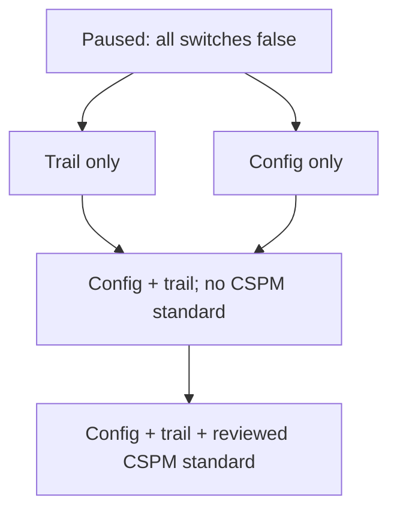

# Independently staged monitoring requests

All monitoring still defaults to paused. This change separates three configuration requests so an approved development instrument check can request telemetry without implicitly subscribing to the CSPM standard. It does not activate a service, grant a start permission, collect data or authorize an experiment.

| Input | Default | Requested effect after separately approved apply |
| --- | --- | --- |
| enable_config_recording | false | Config recorder status on. Existing S3 resource-type scope remains unchanged. |
| enable_cloudtrail_logging | false | Logging on for the existing management trail. Its selectors are unchanged. |
| enable_cspm_standard | false | Existing pinned standard subscription and explicit control manifest. Requires Config recording. |
| enable_collection | false | Compatibility all-on request. Do not combine it with positive independent switches. |

The effective service booleans use the legacy all-on request OR the corresponding independent request. Setting an independent flag false does not override a true legacy switch. To use the new stages, keep enable_collection=false. Mixing the legacy switch with positive independent switches fails planning to make the requested scope unambiguous.

The collection_enabled output now means any monitoring component is requested, not that every component is enabled. Check the reviewed individual inputs for actual scope. With all defaults false, resource and output values remain the existing paused configuration. A private unapplied live plan confirmed no differences; no apply accompanies this change.

## Safe combinations for review

The diagram describes possible reviewed configurations, not an automated progression or deployment authorization. Config plus the CSPM standard can also be requested while leaving trail logging off. CSPM without Config fails the local instrument guard. The legacy all-on interface retains its original behavior for existing reviewed workflows.

## Scope and readiness do not change

Independent switches are not resource-level isolation. Config records all included S3 buckets in the selected region; research-tag scoping of the two direct Config rules does not narrow recording itself. The existing single-region trail requests read/write management events and retains its global-service-events option. It has no object data-event or Insights selector in this stage. Those settings and other trails' overlap must be reviewed before logging starts.

Subscribing to the standard can initially enable broader standard evaluation before the explicit control manifest is applied. This risk and its potential cost remain; the new switches let development telemetry be reviewed separately from that subscription, not bypass the subscription review. Standard/control inventory must be refreshed before any real activation plan if the pinned manifest is stale.

The existing bounded deployment role was prepared for a paused baseline. These booleans do not grant it additional start or standard-management actions. Any needed permission changes require their own scoped policy generation, validation/simulation and reviewed saved plan. Do not fall back to the provisioning user or expand permissions automatically when an activation attempt is denied.

Before any activation: verify identity and regional account inventory, estimate the requested stage and its shared-account scope, review delivery/teardown and retention, prepare exact permission and infrastructure plans, and obtain explicit approval. The existing $100 alert budget is not a spending cutoff. All plan/state/recipient/raw evidence and budget contact details remain private.

To request a pause after an independently staged run, the reviewed configuration must set enable_collection and all three independent switches false. Setting only the old master switch false is not enough if an independent switch remains true. Pausing/removing a standard can change the experimental baseline; do not perform it during a valid trial or discard poor outcomes. Verify actual stopped states and retain late-delivery evidence after the approved administrative change.

## Verification and remaining work

Mocked Terraform tests cover default pause, legacy behavior, each independent telemetry request, telemetry without CSPM, Config+CSPM without trail, rejected CSPM without Config and rejected mixed interfaces. Existing account/root/role guards, storage protections and two-control scope tests remain. These tests use no AWS session.

A separately validated prospective trigger, feasible snapshot schedule, independent delivery checks, finalized baseline result combination and full reviewed scenario catalog remain prerequisites for formal experiments. This staged configuration change does not solve the synthetic exact-endpoint limitation in the current feature extractor or turn retrospective software-check captures into pilot data.
