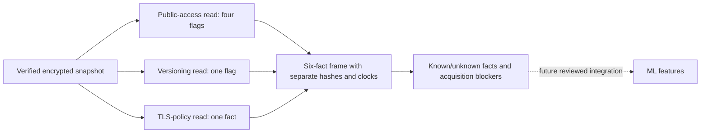

# Development state frames with per-fact provenance

`research/state_frames.py` projects one independently pinned, verified encrypted snapshot into six S3 technical facts while retaining three separate acquisition intervals. It runs locally through the existing trusted decryption callback, makes no AWS call and writes no plaintext. No live evidence is processed by its synthetic tests.

## Interface

`build_state_frame(root, decrypt_record, recipient_sha256, bucket, archive_sha256, record_pins, cutoff_at, max_acquisition_span_seconds)` verifies a complete development snapshot with the existing archive verifier. The caller supplies independently trusted certificate/archive pins and an exact operation-to-record-hash map for get_public_access_block, get_bucket_versioning and get_bucket_policy. The bucket must match the maintained scope. Pins derived only from the same untrusted source do not establish independent trust.

Each selected record must occur exactly once and match both its pin and the maintained request. Facts come from the existing conservative observation adapter, not caller-supplied values or expected labels. Four public-access booleans share their source request; versioning and the recognized TLS denial retain their own sources. Unsupported or missing properties remain null. Existing optional-absence semantics are preserved: for example, an observed NoSuchBucketPolicy gives tls_deny_present=false, while missing public-access configuration does not manufacture four false flags. This module does not reinterpret policy semantics or decide compliance.

For every fact, fact_provenance retains its record/request hashes, original request-start and receipt strings, and source_observed_at=null. Acquisition clocks describe local request handling; they do not establish when AWS's underlying state was observed, whether a response was fresh, or whether the three read results ever existed simultaneously. The observation adapter's internal `end.` names are stripped as technical field names, without assigning them an experiment endpoint time.

## Explicit acquisition limits

The caller must supply a timezone-aware receipt cutoff and a whole-second maximum acquisition span from zero to 1,800, without defaults. These are development review inputs, not approved scientific thresholds. The span runs from the first selected request start to the last selected receipt. Equality at cutoff/span limits passes; later receipts and larger spans produce explicit blockers. The limit does not move the study's 1,800-second detection horizon or imply continuous state coverage.

Because the snapshot collector issues these calls serially, inverted or overlapping/backward selected intervals fail validation. Old archives missing request-start clocks retain their known facts but emit missing_request_timing blockers. Aggregate start/end/span remain null unless all three intervals are available. Present malformed clocks fail rather than being repaired. Unknown facts also block frame_checks_passed.

## Output and remaining boundary

The report contains six boolean/null facts, per-fact provenance, acquisition bounds, cutoff/span settings, archive and binding fingerprints, and blockers. The binding hash includes the reviewed certificate/bucket/archive/record pins and timing settings. It emits no raw service body, certificate, filesystem path, key or answer label. Actual reports and capture identities remain private; there is no automatic plaintext export.

frame_checks_passed means only that the local provenance, known-fact and acquisition checks passed. atomic_snapshot_established, source_freshness_verified, sender_authenticated, provider_delivery_verified, ml_ready and formal_trial_authorized always remain false. CMS encryption and content hashes do not authenticate a capture author. This output intentionally has no aggregate observed_at and cannot be passed directly to the existing exact-endpoint feature extractor.

The next integration must prespecify how independently timed facts support comparisons, validate freshness/trigger/completeness evidence, and retain missing/late observations without outcome-based exclusion. Live tolerances, prospective capture approval, feature-controller integration and formal study release remain unresolved. Tests use real encryption with synthetic clocks/facts to cover six-fact provenance, unknowns, exact bounds, late receipts, legacy timing, substituted pins and impossible serial ordering. Function comments explain purpose, inputs and outputs.
