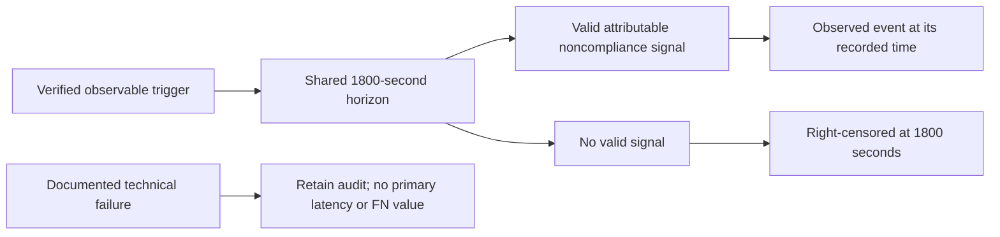

# Observation timing and non-detections

PR #11 is merged. This offline development layer implements proposed timing contracts against the final proposal's fixed 1,800-second horizon. The proposal paragraphs P0882–P0886 were reread from the previously hash-verified final DOCX cache. No AWS collector, activation or research run is implemented by this change.



**Right-censored** means the valid observation window ended without an observed detection. A duration of 1,800 with event_observed=false is different from an actual detection at 1,800 with event_observed=true. Valid noncompliant non-detections remain in latency data and receive false_negative=true. An explicitly invalid matched trial is retained with missing primary latency/FN values rather than relabeled as a missed detection.

## Clock semantics are explicit and still proposed

Three timezone-aware timestamps are retained: source_observed_at describes the evidence observed by the source; detected_at describes when the monitor produced the determination; recorded_at describes when the collection instrument recorded it. UTC offsets normalize to UTC. Naive timestamps, inverted ordering and records claiming to occur after declared ledger closure fail technical checks.

This development contract uses **collector-recorded time** for the proposed primary clock. It therefore includes collection latency. An in-window source/detection timestamp collected after 1,800 is retained in the audit but is not backdated into an eligible primary detection. The exact endpoint is inclusive; a record at 1,800 counts, one later does not. These are implementation proposals requiring review, clock validation and a freeze before formal use; they are not a claim that the proposal already resolves all source-versus-collector timing choices. All original clocks remain available for audit and prespecified sensitivity work. Do not choose a final clock policy after seeing comparative confirmatory results.

## Attribution and first valid signal

The timing input consists of normalized **monitor determinations**, not arbitrary raw CloudTrail events. Each event identifies monitor, trial, scenario, pseudonymous resource and technical target, and retains its raw source status, three clocks and an evidence hash. Wrong trials/resources/targets and stale pre-trigger evidence do not become current detections. Repeated identical IDs are deduplicated; conflicting reused IDs become technical failures. Earliest valid recorded noncompliance is selected deterministically, independent of page/input order. All valid compliant/noncompliant determinations are retained; the module does not select a final accuracy classification or invent the Config/Security Hub fusion policy.

An event that is unusual, unfavorable to either approach, compliant, unknown or simply missing is not automatically a technical failure. In particular, normal-behavior unknowns with WARNING/NOT_AVAILABLE source status remain valid non-detections where appropriate. An explicitly documented instrumentation failure must carry a reason and source-evidence hash. A failure evidenced within the observation window can invalidate the pair even if discovered late before ledger closure. This is a proposed data-quality contract requiring prespecification and review, not authentication that a caller's failure declaration is correct.

The shared window separately declares trigger verification, closure and required-collection completeness. A missing/unverified trigger, unfinished window or incomplete required collection cannot create an apparent healthy censored trial. Those declarations are validated as structured metadata; this code cannot verify that the cloud trigger actually occurred, that all telemetry arrived, or that clocks were synchronized. The live controller and collectors must establish those properties with actual retained evidence before pilot/confirmatory use.

## Persistence before ground-truth evaluation

`write_timing_ledger` accepts the same label-free window for both monitors, retains raw events and both summaries in one exclusive mode-600 JSON file, and hashes the complete payload. It refuses formal phases. The window carries the original catalog, assignment and opaque answer-key fingerprints, never the expected answer itself.

`evaluate_saved_timing` reads that already-saved ledger, checks its version/checksum and recomputed summaries, then verifies the separate answer document's fingerprint, proposal identity and catalog version. Only then is the expected label joined. For valid noncompliant paired cases it derives duration, event flag, censoring flag and FN status. Compliant cases receive no primary noncompliance latency/FN value, and no accuracy/FPR denominator policy is silently chosen. A documented failure of either monitor invalidates paired primary latency derivation while retaining both raw summaries, including any genuine detection by the other approach.

Checksums detect content disagreement; they do not authenticate an adversarially rewritten record. Malformed window schemas may be refused before a ledger can be written; a live ingestion system will need a separate raw/quarantine audit for those failures. This module is not a complete scientific exclusion adjudicator or a live experiment scheduler.

## Demonstration and tests

```sh
python scripts/check_function_docs.py
python -m unittest discover -s tests -v
python scripts/timing_smoke.py --output evidence/new-synthetic-timing.json
```

The smoke command uses explicitly fake clocks and placeholder evidence hashes. It illustrates equal 1,800-second durations with different event/censoring flags. It runs neither model inference nor AWS operations and reports zero research trials. The results are not a performance comparison.

Tests cover attribution, out-of-order records, exact endpoint events, valid non-detections, late arrivals, stale evidence, normal warning/unknowns, late-discovered instrumentation failure, unfinished/unverified windows, timezone offsets, naive/inverted clocks, duplicate/conflicting IDs, changed answer keys, edited ledgers, compliant cases and fixed horizon/formal-phase rejection. Every function documents its purpose, inputs and outputs.

Actual evidence collectors, receipt timestamp capture, trigger/restoration automation, common-cutoff verification, full six-service catalog, frozen exclusion/clock/fusion policy, pilot feasibility, power simulation and R inferential analysis remain pending. AWS collection remains paused.
