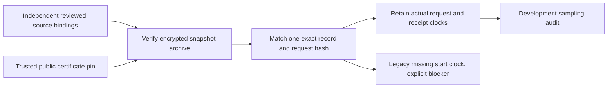

# Verified snapshot receipts for the sampling audit

`research/capture_sampling.py` connects the encrypted-archive verifier to the development sampling audit. It performs local verification/decryption through the caller's trusted callback, with no AWS calls, new capture, model fitting or answer-key join. Tests use ephemeral synthetic keys and genuine CMS ciphertext; the implementation does not obtain or display keys.

## Interface and source binding

`audit_snapshot_sampling(plan, sources, decrypt_record, recipient_sha256, bucket, request_sha256)` takes the existing exact development sampling plan, trusted decryption callback, independently reviewed bucket/certificate/request identities and a bounded list of source bindings. Each source contains only sample_id, root, archive_sha256 and record_sha256. Fingerprints must come from a trusted retained review manifest; calculating expected pins solely from an untrusted archive is not independent verification.

The selected request must be one non-paginated request in the maintained bucket read plan, shared across all samples. For each binding the adapter runs the existing private-file, certificate, ciphertext receipt-chain and decoded scope checks. It then requires the pinned archive fingerprint and exactly one pinned response or supported optional-absence record for the selected request. History archives, mismatched requests, duplicate sample IDs, reuse of a record, extra clock overrides and ground-truth fields are rejected. Malformed sources fail before returning an audit; a rejection is not a scientific trial exclusion decision.

The report includes hash-only source bindings, the sampling audit and explicit legacy-timing blockers. It contains no archive paths, raw service responses, technical facts or expected labels. It writes no plaintext. Decoded records are used in memory; callers must keep the report and its actual capture fingerprints private too. Public-recipient encryption and hashes still do not authenticate the capture author. Sender authentication, provider delivery verification, ML readiness and formal authorization remain false.

## Collector clock addition

Future snapshot captures add request_started_at immediately before a non-paginated SDK invocation, and retain collector_recorded_at immediately after return and before encryption/scope processing. The duration includes the SDK's internal retries and transport processing; it is not an individual HTTP attempt duration or proof of synchronized clocks. Error/optional-absence envelopes retain both clocks too. Existing retry, pagination, item/page caps, encryption and scope guards are unchanged. The complete-archive verifier still refuses failed/truncated captures, so this adapter cannot silently admit their partial records.

Paginated responses retain their existing page receipt clocks. They do not acquire a guessed request-start clock; per-page/attempt instrumentation remains future work and these requests cannot be selected by this adapter. No source-observed time is invented from receipt time, provider Date headers or configuration values; the projected source clock is null. This adapter does not assess source freshness.

Old archives without request_started_at remain readable by the existing observation verifier. This adapter emits capture_request_timing_unavailable and leaves their sampling receipt missing. It does not modify archives, infer a start from a neighboring request, or reconstruct clocks from filenames. Invalid present clocks fail rather than being treated as legacy.

## Scope of the resulting audit

Timing success applies only to the one selected operation in each snapshot. A snapshot contains sequential heterogeneous requests; one receipt cannot represent an atomic six-fact state frame, baseline determination or entire snapshot duration. Trigger verification, per-fact freshness, independent delivery/completeness, feasible sampling tolerances, persistence, model integration and formal protocol freeze remain separate gates. The existing exact-endpoint feature extractor is unchanged.

This change approves no new local capture or cloud action. Any future prospective run needs its own bounded review and explicit approval. Existing development software-check captures remain separate from pilot and confirmatory evidence.
